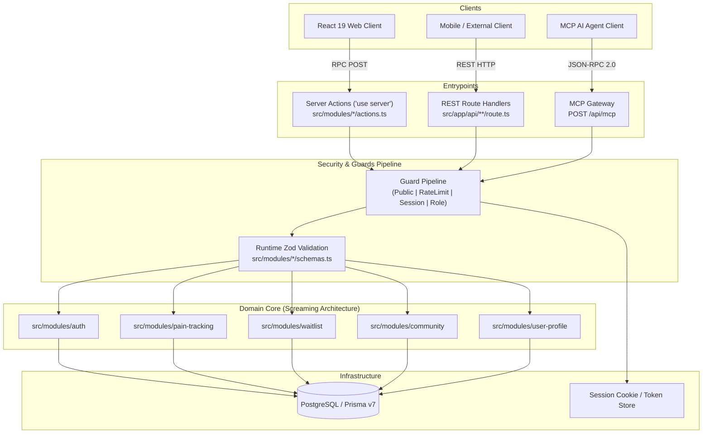
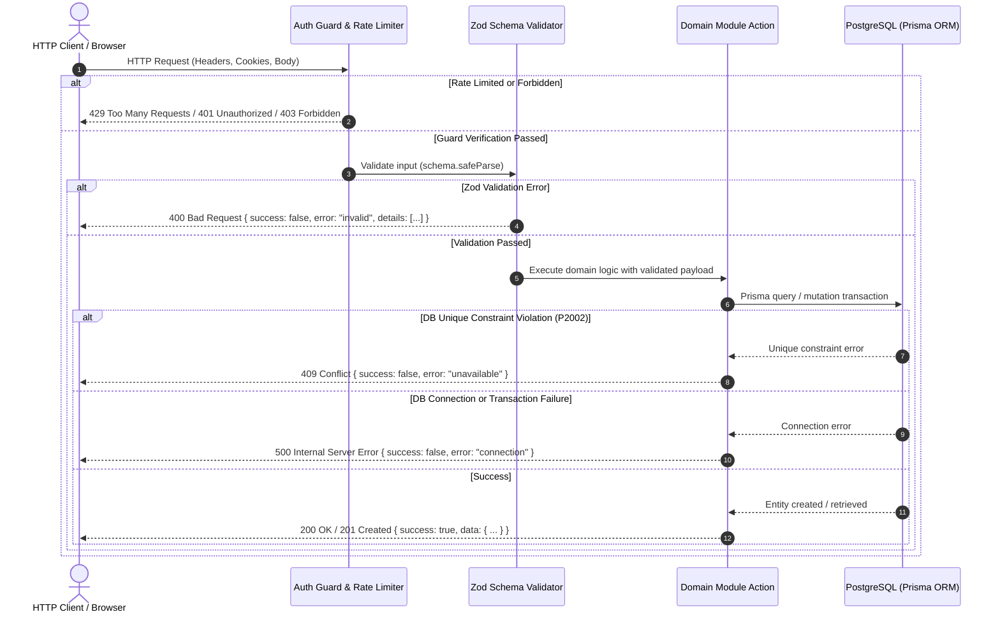

# WITP REST API and Server Actions Specification

> **System**: What is This Pain? (WITP)  
> **Architecture Pattern**: Screaming Architecture / Next.js 16 App Router  
> **API Protocols**: Next.js Server Actions RPC (`"use server"`, implemented) & Standard REST HTTP (`/api/*`, target contract, not implemented yet)  
> **Type Safety & Validation**: End-to-end TypeScript with Zod runtime schema validation  
> **Session Transport**: HTTP-only, secure, lax cookie (`witp-session`). `Authorization: Bearer <token>` is part of the REST target contract and is not implemented yet  
> **Authentication Guards**: `Public`, `Public + Rate Limit`, `Authenticated User`, `Role-based (USER | ADMIN | MEDICAL_EXPERT)`

> [!IMPORTANT]
> **How to read this document.** No `/api/*` route exists yet: every REST section below is the **target contract** for external clients. What runs today is the set of Server Actions listed in [Current Server Action Contracts](#current-server-action-contracts), and their return values differ from the REST payloads. Check the [route matrix](#api-security-route-matrix) for the status of each entry.

---

## Table of Contents

- [Architectural Principles](#architectural-principles)
  - [Dual Protocol Architecture: Server Actions RPC & REST Endpoints](#dual-protocol-architecture-server-actions-rpc-rest-endpoints)
  - [Security Guards and Authorization Pipeline](#security-guards-and-authorization-pipeline)
  - [Standardized Response Envelopes & Error Models](#standardized-response-envelopes-error-models)
  - [HTTP Status Code Semantics](#http-status-code-semantics)
  - [Request Lifecycle Flow](#request-lifecycle-flow)
- [API Security & Route Matrix](#api-security-route-matrix)
- [Implemented Core Modules](#implemented-core-modules)
  - [Current Server Action Contracts](#current-server-action-contracts)
  - [1. Authentication Module (`src/modules/auth`)](#1-authentication-module-srcmodulesauth)
    - [`POST /api/auth/register`](#post-apiauthregister)
    - [`POST /api/auth/login`](#post-apiauthlogin)
    - [`POST /api/auth/logout`](#post-apiauthlogout)
  - [2. Pain Tracking Module (`src/modules/pain-tracking`)](#2-pain-tracking-module-srcmodulespain-tracking)
    - [`GET /api/pains`](#get-apipains)
    - [`POST /api/pains`](#post-apipains)
  - [3. Waitlist Module (`src/modules/waitlist`)](#3-waitlist-module-srcmoduleswaitlist)
    - [`POST /api/waitlist`](#post-apiwaitlist)
- [Roadmap & Planned Modules [ROADMAP]](#roadmap-planned-modules-roadmap)
  - [4. Community Module (`src/modules/community`)](#4-community-module-srcmodulescommunity)
    - [`POST /api/community/posts`](#post-apicommunityposts)
    - [`GET /api/community/posts`](#get-apicommunityposts)
    - [`POST /api/community/comments`](#post-apicommunitycomments)
    - [`POST /api/community/likes`](#post-apicommunitylikes)
    - [`POST /api/community/blog`](#post-apicommunityblog)
  - [5. User Profile Module (`src/modules/user-profile`)](#5-user-profile-module-srcmodulesuser-profile)
    - [`GET /api/users/:username`](#get-apiusersusername)
    - [`PATCH /api/users/me/profile`](#patch-apiusersmeprofile)
    - [`PATCH /api/users/me/settings`](#patch-apiusersmesettings)
    - [`POST /api/users/:userId/follow`](#post-apiusersuseridfollow)
  - [6. AI Agent Subsystems & MCP Protocol](#6-ai-agent-subsystems-mcp-protocol)
    - [`POST /api/ai/analyze-pain`](#post-apiaianalyze-pain)
    - [`POST /api/ai/moderate`](#post-apiaimoderate)
    - [`POST /api/mcp`](#post-apimcp)
- [Client Integration Guidelines](#client-integration-guidelines)
  - [Calling via React Server Actions](#calling-via-react-server-actions)
  - [Calling via Standard REST Fetch](#calling-via-standard-rest-fetch)

---

## Architectural Principles

### Dual Protocol Architecture: Server Actions RPC & REST Endpoints

WITP is designed around a dual-interface model. Only the Server Actions interface exists today:
1. **Next.js Server Actions RPC (`"use server"`)**: Used natively by React Server and Client Components within the web application. Server Actions eliminate client bundle bloat, enforce CSRF header verification automatically, and leverage Next.js cache revalidation (`revalidatePath`).
2. **REST HTTP Endpoints (`/api/*`) *[ROADMAP]***: Standardized RESTful endpoints compliant with RFC 9110 HTTP semantics for external mobile apps, third-party medical integrations, headless clients, and automated integration suites.

Once implemented, both interfaces will share identical domain layers, Prisma database transactions, Zod schemas, security guards, and error codes.



### Security Guards and Authorization Pipeline

Every endpoint and Server Action is assigned one of four access control tiers:

1. **`Public`**:
   - Invocable without authentication credentials or session tokens.
   - Intended for static public queries, public user profiles, or forum read operations.
2. **`Public + Rate Limit`**:
   - Invocable by anonymous callers, but throttled by an in-memory fixed-window limiter (`allowAttempt`). State is per process, so serverless instances do not share counters until a shared store replaces it.
   - Authentication attempts are limited to 8 attempts per 15-minute window per email (`allowAuthAttempt`).
   - Waitlist registrations are limited to 5 attempts per 10-minute window per IP address, read from the first `x-forwarded-for` value. That header is only trustworthy behind a proxy that sets it, such as Vercel.
3. **`Authenticated User`**:
   - Requires a valid, unexpired session resolved via [`getSessionUser()`](../src/infrastructure/auth/session.ts).
   - Authentication state is verified by:
     - `Cookie: witp-session=<session_token>` (hex string, 64 characters)
     - `Authorization: Bearer <session_token>` *[ROADMAP: REST only]*
   - The session token is hashed with SHA-256 (`tokenHash`) and verified against the `Session` database table. The associated [`User`](../prisma/schema.prisma) must have `status === "ACTIVE"`.
4. **`Role-based (USER | ADMIN | MEDICAL_EXPERT)`**:
   - Requires an authenticated user session plus verification that [`User.role`](../prisma/schema.prisma) possesses the requisite permission level:
     - `USER`: General registered patients and community participants.
     - `MEDICAL_EXPERT`: Verified clinicians permitted to author medical blog guides and clinical content.
     - `ADMIN`: Full administrative control over user accounts, content moderation, and platform configuration.

### Standardized Response Envelopes & Error Models

All REST responses will adhere to a consistent JSON envelope schema. Server Actions return the shapes in [Current Server Action Contracts](#current-server-action-contracts) instead:

#### Success Envelope (`200 OK`, `201 Created`)
```json
{
  "success": true,
  "data": { ... }
}
```

#### Error Envelope (`4xx`, `5xx`)
```json
{
  "success": false,
  "error": "error_code_identifier",
  "message": "Human-readable explanation of the error condition.",
  "details": [ ... ]
}
```

### HTTP Status Code Semantics

| HTTP Status | Semantic Meaning in WITP |
| :--- | :--- |
| `200 OK` | The request succeeded. Returned for successful queries (`GET`), updates (`PATCH`), or non-creation mutations (`POST`). |
| `201 Created` | The resource was created successfully. Returned for successful registrations, posts, pain logs, and comments. |
| `400 Bad Request` | Payload or query parameter failed Zod validation, missing required fields, or illegal values. |
| `401 Unauthorized` | Missing, expired, or invalid session cookie / Bearer token; or invalid login credentials. |
| `403 Forbidden` | Authenticated caller does not have sufficient role permissions (`MEDICAL_EXPERT` / `ADMIN`) or account is suspended. |
| `404 Not Found` | Requested entity (user, post, comment, anatomical mesh) does not exist in the database. |
| `409 Conflict` | Unique constraint violation (e.g. duplicate email in registration or waitlist, duplicate reaction). |
| `429 Too Many Requests` | Request rate limit exceeded (e.g. brute force threshold or daily AI quota reached). |
| `500 Internal Server Error` | Database connection error, unexpected runtime exception, or external service failure. |

### Request Lifecycle Flow



---

## API Security & Route Matrix

| HTTP Method & Route | Module | Guard Level | Permitted Roles | Rate Limit | REST Route | Server Action | Validation Schema |
| :--- | :--- | :--- | :--- | :--- | :--- | :--- | :--- |
| `POST /api/auth/register` | `auth` | `Public + Rate Limit` | Anonymous | 8 req / 15 min per email | *[ROADMAP]* | **Implemented**: [`authenticate`](../src/modules/auth/actions.ts) | `authSchema` |
| `POST /api/auth/login` | `auth` | `Public + Rate Limit` | Anonymous | 8 req / 15 min per email | *[ROADMAP]* | **Implemented**: [`authenticate`](../src/modules/auth/actions.ts) | `authSchema` |
| `POST /api/auth/logout` | `auth` | `Authenticated User` (the action itself is idempotent and unguarded) | `USER`, `ADMIN`, `MEDICAL_EXPERT` | None | *[ROADMAP]* | **Implemented**: [`signOut`](../src/modules/auth/actions.ts) | None |
| `GET /api/pains` | `pain-tracking` | `Authenticated User` | `USER`, `ADMIN`, `MEDICAL_EXPERT` | None | *[ROADMAP]* | **Implemented**: [`getPainHistory`](../src/modules/pain-tracking/actions.ts) | None (no input) |
| `POST /api/pains` | `pain-tracking` | `Authenticated User` | `USER`, `ADMIN`, `MEDICAL_EXPERT` | None | *[ROADMAP]* | **Implemented**: [`createPainRecord`](../src/modules/pain-tracking/actions.ts) | `painRecordSchema` |
| `POST /api/waitlist` | `waitlist` | `Public + Rate Limit` | Anonymous | 5 req / 10 min per IP | *[ROADMAP]* | **Implemented**: [`subscribeToWaitlist`](../src/modules/waitlist/actions.ts) | `waitlistSchema` |
| `POST /api/community/posts` | `community` | `Authenticated User` | `USER`, `ADMIN`, `MEDICAL_EXPERT` | 10 req / hour | *[ROADMAP]* | *[ROADMAP]*: `createPost` | **Implemented**: `createPostSchema` |
| `GET /api/community/posts` | `community` | `Public` | All | None | *[ROADMAP]* | *[ROADMAP]*: `getPosts` | **Implemented**: `listPostsSchema` |
| `POST /api/community/comments` | `community` | `Authenticated User` | `USER`, `ADMIN`, `MEDICAL_EXPERT` | 30 req / hour | *[ROADMAP]* | *[ROADMAP]*: `createComment` | **Implemented**: `createCommentSchema` |
| `POST /api/community/likes` | `community` | `Authenticated User` | `USER`, `ADMIN`, `MEDICAL_EXPERT` | None | *[ROADMAP]* | *[ROADMAP]*: `toggleLike` | **Implemented**: `toggleLikeSchema` |
| `POST /api/community/blog` | `community` | `Role-based` | `MEDICAL_EXPERT`, `ADMIN` | None | *[ROADMAP]* | *[ROADMAP]*: `createBlogEntry` | **Implemented**: `createBlogEntrySchema` |
| `GET /api/users/:username` | `user-profile` | `Public` | All | None | *[ROADMAP]* | *[ROADMAP]*: `getUserProfile` | **Implemented**: `usernameSchema` |
| `PATCH /api/users/me/profile` | `user-profile` | `Authenticated User` | `USER`, `ADMIN`, `MEDICAL_EXPERT` | None | *[ROADMAP]* | *[ROADMAP]*: `updateUserProfile` | **Implemented**: `updateProfileSchema` |
| `PATCH /api/users/me/settings` | `user-profile` | `Authenticated User` | `USER`, `ADMIN`, `MEDICAL_EXPERT` | None | *[ROADMAP]* | *[ROADMAP]*: `updateUserSettings` | **Implemented**: `updateSettingsSchema` |
| `POST /api/users/:userId/follow` | `user-profile` | `Authenticated User` | `USER`, `ADMIN`, `MEDICAL_EXPERT` | None | *[ROADMAP]* | *[ROADMAP]*: `toggleFollowUser` | **Implemented**: `followUserSchema` |
| `POST /api/ai/analyze-pain` | `pain-tracking/ai` | `Authenticated User` | `USER`, `ADMIN`, `MEDICAL_EXPERT` | 5 analyses / day | *[ROADMAP]* | *[ROADMAP]*: `PainAnalystAgent.run` | *[ROADMAP]* |
| `POST /api/ai/moderate` | `community/ai` | `Role-based` | Internal Worker, `ADMIN` | None | *[ROADMAP]* | *[ROADMAP]*: `ModerationAgent.scan` | *[ROADMAP]* |
| `POST /api/mcp` | `ai/mcp` | `Authenticated User` | Agent Token, `ADMIN` | None | *[ROADMAP]* | *[ROADMAP]*: `MCP JSON-RPC Gateway` | *[ROADMAP]* |

---

## Implemented Core Modules

### Current Server Action Contracts

These are the contracts that run in production today. Validation happens before the session check in `createPainRecord`, and before the rate limit in `authenticate`. `subscribeToWaitlist` checks the rate limit first.

| Server Action | Input | Guard | Success Result | Failure Result |
| :--- | :--- | :--- | :--- | :--- |
| [`authenticate`](../src/modules/auth/actions.ts) | `authSchema`: `{ mode, email, password, username? }` | 8 attempts / 15 min per email | `{ success: true }`, plus the `witp-session` cookie | `{ error: "invalid" \| "rateLimited" \| "credentials" \| "unavailable" \| "connection" }` |
| [`signOut`](../src/modules/auth/actions.ts) | None | None (safe without a session) | `undefined`; session row and cookie removed | Throws on database failure |
| [`createPainRecord`](../src/modules/pain-tracking/actions.ts) | `painRecordSchema`: `{ meshId, intensity, notes?, recordedAt }` | Session required | `{ success: true }` | `{ error: "invalid" \| "unauthorized" \| "missingRegion" \| "connection" }` |
| [`getPainHistory`](../src/modules/pain-tracking/actions.ts) | None | Session optional; anonymous callers get an empty list | `{ entries: PainEntry[] }`, newest 20 | `{ entries: [], error: "connection" }` |
| [`subscribeToWaitlist`](../src/modules/waitlist/actions.ts) | `waitlistSchema`: `{ email }` | 5 attempts / 10 min per IP | `{ success: true }` | `{ success: false, error: "invalid" \| "duplicate" \| "rateLimited" \| "connection" }` |

The sections below specify the REST target contract for each module. The query parameters of `GET /api/pains`, `totalCount`, and the `data` objects in the REST responses are not produced by the Server Actions.

### 1. Authentication Module (`src/modules/auth`)

#### `POST /api/auth/register`

Registers a new user account with scrypt password hashing, provisions an initial active session, and returns an HTTP-only session cookie.

- **HTTP Method & Route**: `POST /api/auth/register`
- **Guard & Access Control**: `Public + Rate Limit`
  - Max 8 registration attempts per 15-minute fixed window per email address via [`allowAuthAttempt`](../src/infrastructure/auth/rate-limit.ts).
- **Request Specification**:
  - **Headers Required**:
    - `Content-Type: application/json`
  - **Query Parameters**: None.
  - **Request Body JSON Schema**:
    | Field | Type | Nullable | Constraints | Description |
    | :--- | :--- | :--- | :--- | :--- |
    | `email` | `string` | No | Valid email, max 254 characters, lowercase normalized | User login email |
    | `password` | `string` | No | Min 12, max 128 characters | Raw password to be scrypt-hashed |
    | `username` | `string` | No | Min 3, max 30 chars, matching `/^[\p{L}\p{N}_-]+$/u` | Unique user handle |

##### Request Body Example
```json
{
  "email": "jane.doe@example.com",
  "password": "CorrectHorseBatteryStaple123!",
  "username": "janedoe"
}
```

##### Response Specifications (Status Codes & Payloads)

| HTTP Status | Condition When Returned |
| :--- | :--- |
| `201 Created` | Account created successfully; session cookie `witp-session` set in `Set-Cookie` header. |
| `400 Bad Request` | Validation failure (password < 12 chars, invalid email, username missing or containing illegal characters). |
| `409 Conflict` | Unique constraint violation (`P2002`): username or email is already registered. |
| `429 Too Many Requests` | Exceeded 8 attempts per 15 minutes for the specified email. |
| `500 Internal Server Error` | Database connection error or unhandled server fault. |

###### Concrete Response Payloads

**`201 Created`**:
```json
{
  "success": true,
  "data": {
    "userId": "d7486e92-36c9-4b68-b7eb-8c679901ad41",
    "username": "janedoe",
    "email": "jane.doe@example.com",
    "role": "USER",
    "status": "ACTIVE",
    "createdAt": "2026-10-10T19:00:00.000Z"
  }
}
```

**`400 Bad Request`**:
```json
{
  "success": false,
  "error": "invalid",
  "message": "Validation failed",
  "details": [
    {
      "path": ["password"],
      "message": "String must contain at least 12 character(s)"
    }
  ]
}
```

**`409 Conflict`**:
```json
{
  "success": false,
  "error": "unavailable",
  "message": "Email or username is already taken"
}
```

**`429 Too Many Requests`**:
```json
{
  "success": false,
  "error": "rateLimited",
  "message": "Too many authentication attempts. Please try again in 15 minutes."
}
```

**`500 Internal Server Error`**:
```json
{
  "success": false,
  "error": "connection",
  "message": "Database connection error or unhandled internal fault"
}
```

- **Mapping to Code**:
  - Corresponding Server Action: [`authenticate`](../src/modules/auth/actions.ts) invoked with `{ mode: "register", ... }` in [src/modules/auth/actions.ts](../src/modules/auth/actions.ts).
  - Validation Schema: [`authSchema`](../src/modules/auth/schemas.ts) in [src/modules/auth/schemas.ts](../src/modules/auth/schemas.ts).
  - Prisma Models: [`User`](../prisma/schema.prisma), [`Session`](../prisma/schema.prisma).

---

#### `POST /api/auth/login`

Authenticates existing user credentials, applies constant-time verification to prevent account enumeration, and issues an active session token.

- **HTTP Method & Route**: `POST /api/auth/login`
- **Guard & Access Control**: `Public + Rate Limit`
  - Max 8 login attempts per 15-minute fixed window per email address via [`allowAuthAttempt`](../src/infrastructure/auth/rate-limit.ts).
- **Request Specification**:
  - **Headers Required**:
    - `Content-Type: application/json`
  - **Query Parameters**: None.
  - **Request Body JSON Schema**:
    | Field | Type | Nullable | Constraints | Description |
    | :--- | :--- | :--- | :--- | :--- |
    | `email` | `string` | No | Valid email, max 254 characters, lowercase normalized | Registered user email |
    | `password` | `string` | No | Min 12, max 128 characters | Raw password to verify |

##### Request Body Example
```json
{
  "email": "jane.doe@example.com",
  "password": "CorrectHorseBatteryStaple123!"
}
```

##### Response Specifications (Status Codes & Payloads)

| HTTP Status | Condition When Returned |
| :--- | :--- |
| `200 OK` | Credentials validated successfully; new session stored and `witp-session` cookie issued. |
| `400 Bad Request` | Payload failed Zod parsing (malformed email syntax or password outside 12-128 chars). |
| `401 Unauthorized` | Password mismatch, unregistered email, or account status is not `ACTIVE`. *Note: An identical dummy scrypt calculation is executed for non-existent emails to prevent account-existence timing side-channels.* |
| `429 Too Many Requests` | Exceeded 8 attempts per 15 minutes for the specified email. |
| `500 Internal Server Error` | Database connection error or unhandled internal fault. |

###### Concrete Response Payloads

**`200 OK`**:
```json
{
  "success": true,
  "data": {
    "userId": "d7486e92-36c9-4b68-b7eb-8c679901ad41",
    "username": "janedoe",
    "role": "USER",
    "status": "ACTIVE"
  }
}
```

**`400 Bad Request`**:
```json
{
  "success": false,
  "error": "invalid",
  "message": "Validation failed: invalid email address"
}
```

**`401 Unauthorized`**:
```json
{
  "success": false,
  "error": "credentials",
  "message": "Invalid email or password"
}
```

**`429 Too Many Requests`**:
```json
{
  "success": false,
  "error": "rateLimited",
  "message": "Too many authentication attempts. Please try again in 15 minutes."
}
```

**`500 Internal Server Error`**:
```json
{
  "success": false,
  "error": "connection",
  "message": "Database connection error or unhandled internal fault"
}
```

- **Mapping to Code**:
  - Corresponding Server Action: [`authenticate`](../src/modules/auth/actions.ts) invoked with `{ mode: "login", ... }` in [src/modules/auth/actions.ts](../src/modules/auth/actions.ts).
  - Validation Schema: [`authSchema`](../src/modules/auth/schemas.ts) in [src/modules/auth/schemas.ts](../src/modules/auth/schemas.ts).
  - Prisma Models: [`User`](../prisma/schema.prisma), [`Session`](../prisma/schema.prisma).

---

#### `POST /api/auth/logout`

Revokes the active user session in the database and clears the `witp-session` HTTP cookie.

- **HTTP Method & Route**: `POST /api/auth/logout`
- **Guard & Access Control**: `Authenticated User` (`USER`, `ADMIN`, `MEDICAL_EXPERT`).
- **Request Specification**:
  - **Headers Required**:
    - `Cookie: witp-session=<session_token>` OR `Authorization: Bearer <session_token>`
  - **Query Parameters**: None.
  - **Request Body**: None (empty body).

##### Response Specifications (Status Codes & Payloads)

| HTTP Status | Condition When Returned |
| :--- | :--- |
| `200 OK` | Session revoked successfully; session row deleted from database and cookie cleared. |
| `401 Unauthorized` | Missing or invalid session token in cookies or authorization header. |
| `500 Internal Server Error` | Database connection error. |

###### Concrete Response Payloads

**`200 OK`**:
```json
{
  "success": true,
  "message": "Logged out successfully"
}
```

**`401 Unauthorized`**:
```json
{
  "success": false,
  "error": "unauthorized",
  "message": "No active session found"
}
```

**`500 Internal Server Error`**:
```json
{
  "success": false,
  "error": "connection",
  "message": "Failed to revoke session due to database communication failure"
}
```

- **Mapping to Code**:
  - Corresponding Server Action: [`signOut`](../src/modules/auth/actions.ts) in [src/modules/auth/actions.ts](../src/modules/auth/actions.ts).
  - Helper Function: [`deleteSession`](../src/infrastructure/auth/session.ts) in [src/infrastructure/auth/session.ts](../src/infrastructure/auth/session.ts).
  - Prisma Model: [`Session`](../prisma/schema.prisma).

---

### 2. Pain Tracking Module (`src/modules/pain-tracking`)

#### `GET /api/pains`

Retrieves the authenticated user's recent pain records ordered chronologically, with anatomical mesh identifiers for 3D visualization and heatmap rendering.

- **HTTP Method & Route**: `GET /api/pains`
- **Guard & Access Control**: `Authenticated User` (`USER`, `ADMIN`, `MEDICAL_EXPERT`).
- **Request Specification**:
  - **Headers Required**:
    - `Cookie: witp-session=<session_token>` OR `Authorization: Bearer <session_token>`
  - **Query Parameters**:
    | Parameter | Type | Required | Default | Description |
    | :--- | :--- | :--- | :--- | :--- |
    | `limit` | `integer` | No | `20` | Maximum number of records to return (1-100) |
    | `meshId` | `string` | No | `undefined` | Filter records to a specific canonical body part mesh |
    | `startDate` | `string` | No | `undefined` | ISO 8601 date string (`YYYY-MM-DD`) filter floor |
    | `endDate` | `string` | No | `undefined` | ISO 8601 date string (`YYYY-MM-DD`) filter ceiling |
  - **Request Body**: None (`GET` request).

##### Response Specifications (Status Codes & Payloads)

| HTTP Status | Condition When Returned |
| :--- | :--- |
| `200 OK` | Pain history retrieved successfully. |
| `400 Bad Request` | Invalid query parameters (e.g. invalid date format, unrecognized `meshId`, limit > 100). |
| `401 Unauthorized` | Missing or invalid session authentication. |
| `500 Internal Server Error` | Database connection error. |

###### Concrete Response Payloads

**`200 OK`**:
```json
{
  "success": true,
  "data": {
    "entries": [
      {
        "id": "e47b99ad-29ab-48d6-942f-8dbe8f45a271",
        "meshId": "lumbar_spine",
        "intensity": 6,
        "notes": "Dull ache after 4 hours of desk work. Radiates slightly into left glute.",
        "recordedAt": "2026-10-10"
      },
      {
        "id": "f8a02c31-7b3e-436f-b258-00e12d4a6782",
        "meshId": "cervical_spine",
        "intensity": 4,
        "notes": "Morning stiffness following overnight flight.",
        "recordedAt": "2026-10-09"
      }
    ],
    "totalCount": 2
  }
}
```

**`400 Bad Request`**:
```json
{
  "success": false,
  "error": "invalid_parameters",
  "message": "Query parameter 'meshId' is not a valid anatomical region identifier"
}
```

**`401 Unauthorized`**:
```json
{
  "success": false,
  "error": "unauthorized",
  "message": "Authentication required to access pain records"
}
```

**`500 Internal Server Error`**:
```json
{
  "success": false,
  "error": "connection",
  "message": "Database query failed while fetching pain history"
}
```

- **Mapping to Code**:
  - Corresponding Server Action: [`getPainHistory`](../src/modules/pain-tracking/actions.ts) in [src/modules/pain-tracking/actions.ts](../src/modules/pain-tracking/actions.ts).
  - TypeScript Types: [`PainEntry`](../src/modules/pain-tracking/schemas.ts) in [src/modules/pain-tracking/schemas.ts](../src/modules/pain-tracking/schemas.ts).
  - Prisma Model: [`PainRecord`](../prisma/schema.prisma), [`BodyPart`](../prisma/schema.prisma).

---

#### `POST /api/pains`

Creates a new pain observation linking a 1-10 intensity rating and optional clinical notes to a specific 3D anatomical mesh node.

- **HTTP Method & Route**: `POST /api/pains`
- **Guard & Access Control**: `Authenticated User` (`USER`, `ADMIN`, `MEDICAL_EXPERT`).
- **Request Specification**:
  - **Headers Required**:
    - `Content-Type: application/json`
    - `Cookie: witp-session=<session_token>` OR `Authorization: Bearer <session_token>`
  - **Query Parameters**: None.
  - **Request Body JSON Schema**:
    | Field | Type | Nullable | Constraints | Description |
    | :--- | :--- | :--- | :--- | :--- |
    | `meshId` | `string` | No | Must be one of canonical [`bodyParts[number].meshId`](../src/shared/anatomy.ts) | Anatomical node ID |
    | `intensity` | `integer` | No | Integer in range `1` to `10` inclusive | Visual Analogue Scale (VAS) pain severity |
    | `notes` | `string` | Yes | Max 2000 characters, whitespace trimmed, defaults to `""` | User comments / symptoms |
    | `recordedAt` | `string` | No | ISO 8601 date string `YYYY-MM-DD`, cannot be > 24 hours into future | Date of pain event |

##### Request Body Example
```json
{
  "meshId": "lumbar_spine",
  "intensity": 7,
  "notes": "Sharp pain when bending forward to tie shoes. Accompanied by muscle spasms.",
  "recordedAt": "2026-10-10"
}
```

##### Response Specifications (Status Codes & Payloads)

| HTTP Status | Condition When Returned |
| :--- | :--- |
| `201 Created` | Pain record created and committed in `PainRecord` table. Layout revalidated. |
| `400 Bad Request` | Zod validation failed (intensity out of range, notes > 2000 chars, invalid meshId, or date > 24h future). |
| `401 Unauthorized` | Session missing, invalid, or expired. |
| `404 Not Found` | Provided `meshId` does not correspond to an existing row in the `BodyPart` database table (`missingRegion`). |
| `500 Internal Server Error` | Database transaction error or connection fault. |

###### Concrete Response Payloads

**`201 Created`**:
```json
{
  "success": true,
  "data": {
    "id": "5fa23d19-bca1-4f16-9ef0-e7178a3c89b2",
    "meshId": "lumbar_spine",
    "intensity": 7,
    "notes": "Sharp pain when bending forward to tie shoes. Accompanied by muscle spasms.",
    "recordedAt": "2026-10-10",
    "createdAt": "2026-10-10T19:05:00.000Z"
  }
}
```

**`400 Bad Request`**:
```json
{
  "success": false,
  "error": "invalid",
  "message": "Validation failed",
  "details": [
    {
      "path": ["intensity"],
      "message": "Number must be greater than or equal to 1"
    }
  ]
}
```

**`401 Unauthorized`**:
```json
{
  "success": false,
  "error": "unauthorized",
  "message": "Active session required to record pain entries"
}
```

**`404 Not Found`**:
```json
{
  "success": false,
  "error": "missingRegion",
  "message": "The specified anatomical mesh region does not exist in the database catalog"
}
```

**`500 Internal Server Error`**:
```json
{
  "success": false,
  "error": "connection",
  "message": "Database transaction failure while creating pain record"
}
```

- **Mapping to Code**:
  - Corresponding Server Action: [`createPainRecord`](../src/modules/pain-tracking/actions.ts) in [src/modules/pain-tracking/actions.ts](../src/modules/pain-tracking/actions.ts).
  - Validation Schema: [`painRecordSchema`](../src/modules/pain-tracking/schemas.ts) in [src/modules/pain-tracking/schemas.ts](../src/modules/pain-tracking/schemas.ts).
  - Anatomy Contract: [`isMeshId`](../src/shared/anatomy.ts) in [src/shared/anatomy.ts](../src/shared/anatomy.ts).
  - Prisma Models: [`PainRecord`](../prisma/schema.prisma), [`BodyPart`](../prisma/schema.prisma).

---

### 3. Waitlist Module (`src/modules/waitlist`)

#### `POST /api/waitlist`

Subscribes an interested user to early platform access by recording their unique email.

- **HTTP Method & Route**: `POST /api/waitlist`
- **Guard & Access Control**: `Public + Rate Limit`
  - 5 submissions per 10 minutes per IP address.
- **Request Specification**:
  - **Headers Required**:
    - `Content-Type: application/json`
  - **Query Parameters**: None.
  - **Request Body JSON Schema**:
    | Field | Type | Nullable | Constraints | Description |
    | :--- | :--- | :--- | :--- | :--- |
    | `email` | `string` | No | Valid email syntax, max 254 characters | Prospective user contact email |

##### Request Body Example
```json
{
  "email": "innovator@biotech.org"
}
```

##### Response Specifications (Status Codes & Payloads)

| HTTP Status | Condition When Returned |
| :--- | :--- |
| `201 Created` | Email successfully registered in `WaitlistEmail` table. |
| `400 Bad Request` | Email syntax validation failed. |
| `409 Conflict` | Email is already registered in the waitlist (`P2002`). |
| `429 Too Many Requests` | IP rate limit exceeded. |
| `500 Internal Server Error` | Database connection error or unhandled failure. |

###### Concrete Response Payloads

**`201 Created`**:
```json
{
  "success": true,
  "data": {
    "id": "a9010bc2-0041-45f8-8a8f-287dfb6ef120",
    "email": "innovator@biotech.org",
    "createdAt": "2026-10-10T19:10:00.000Z"
  },
  "message": "Thank you for joining our waitlist!"
}
```

**`400 Bad Request`**:
```json
{
  "success": false,
  "error": "invalid",
  "message": "Invalid email address"
}
```

**`409 Conflict`**:
```json
{
  "success": false,
  "error": "duplicate",
  "message": "Email already registered"
}
```

**`429 Too Many Requests`**:
```json
{
  "success": false,
  "error": "rateLimited",
  "message": "Too many waitlist submissions from this IP address. Please try again later."
}
```

**`500 Internal Server Error`**:
```json
{
  "success": false,
  "error": "connection",
  "message": "Something went wrong"
}
```

- **Mapping to Code**:
  - Corresponding Server Action: [`subscribeToWaitlist`](../src/modules/waitlist/actions.ts) in [src/modules/waitlist/actions.ts](../src/modules/waitlist/actions.ts).
  - Validation Schema: [`waitlistSchema`](../src/modules/waitlist/schemas.ts) in [src/modules/waitlist/schemas.ts](../src/modules/waitlist/schemas.ts).
  - Prisma Model: [`WaitlistEmail`](../prisma/schema.prisma).

---

## Roadmap & Planned Modules [ROADMAP]

The Zod schemas for the community and user-profile endpoints are implemented in [`src/modules/community/schemas.ts`](../src/modules/community/schemas.ts) and [`src/modules/user-profile/schemas.ts`](../src/modules/user-profile/schemas.ts). Their Server Actions, UI, AI agents and MCP gateway are not implemented, and the related pages render a coming-soon view.

### 4. Community Module (`src/modules/community`)

#### `POST /api/community/posts`

Publishes a community discussion post pinned to a specific anatomical region (`BodyPart`).

- **HTTP Method & Route**: `POST /api/community/posts`
- **Guard & Access Control**: `Authenticated User` (`USER`, `ADMIN`, `MEDICAL_EXPERT`).
  - Rate limit: 10 posts per hour per user.
- **Request Specification**:
  - **Headers Required**:
    - `Content-Type: application/json`
    - `Cookie: witp-session=<session_token>` OR `Authorization: Bearer <session_token>`
  - **Query Parameters**: None.
  - **Request Body JSON Schema**:
    | Field | Type | Nullable | Constraints | Description |
    | :--- | :--- | :--- | :--- | :--- |
    | `title` | `string` | No | Min 5, max 150 characters, trimmed | Post title |
    | `content` | `string` | No | Min 20, max 10000 characters, trimmed | Body text / Markdown |
    | `meshId` | `string` | No | Must match canonical [`bodyParts[number].meshId`](../src/shared/anatomy.ts) | Anatomical focus node |
    | `imageUrl` | `string` | Yes | Valid HTTP(S) URL, optional | Attached diagnostic or context image |

##### Request Body Example
```json
{
  "title": "Persistent Sharp Pain on Lateral Side of Right Knee After Running",
  "content": "For the past two weeks, every time I exceed 3 miles I feel a sharp burning sensation on the outside of my right knee. Resting relieves it within an hour. Has anyone experienced IT band syndrome presenting like this?",
  "meshId": "knee_r",
  "imageUrl": "https://cdn.witp.health/uploads/posts/knee_lateral_view.jpg"
}
```

##### Response Specifications (Status Codes & Payloads)

| HTTP Status | Condition When Returned |
| :--- | :--- |
| `201 Created` | Post successfully created and committed to the `Post` table. |
| `400 Bad Request` | Input failed validation (title < 5 chars, content < 20 chars, invalid `meshId`, malformed URL). |
| `401 Unauthorized` | Caller lacks a valid active session. |
| `403 Forbidden` | Account status is `SUSPENDED` or `INACTIVE`. |
| `404 Not Found` | Anatomical mesh identifier has no corresponding database record in `BodyPart`. |
| `429 Too Many Requests` | Exceeded post creation rate limit (10 posts per hour). |
| `500 Internal Server Error` | Database connection error. |

###### Concrete Response Payloads

**`201 Created`**:
```json
{
  "success": true,
  "data": {
    "postId": "b182cf09-7756-42bb-9877-3e1cb16016da",
    "title": "Persistent Sharp Pain on Lateral Side of Right Knee After Running",
    "meshId": "knee_r",
    "createdAt": "2026-10-10T19:15:00.000Z"
  }
}
```

**`400 Bad Request`**:
```json
{
  "success": false,
  "error": "invalid_input",
  "message": "Post title must contain at least 5 characters"
}
```

**`401 Unauthorized`**:
```json
{
  "success": false,
  "error": "unauthorized",
  "message": "Authentication required to publish community posts"
}
```

**`403 Forbidden`**:
```json
{
  "success": false,
  "error": "forbidden",
  "message": "Your account has been suspended from publishing community content"
}
```

**`404 Not Found`**:
```json
{
  "success": false,
  "error": "body_part_not_found",
  "message": "The specified body part region does not exist"
}
```

**`429 Too Many Requests`**:
```json
{
  "success": false,
  "error": "rate_limited",
  "message": "Post limit reached: maximum 10 posts per hour allowed"
}
```

**`500 Internal Server Error`**:
```json
{
  "success": false,
  "error": "internal_error",
  "message": "Failed to store community post due to internal database fault"
}
```

- **Mapping to Code**:
  - Corresponding Server Action: [`createPost`](../src/modules/community/actions.ts) in [src/modules/community/actions.ts](../src/modules/community/actions.ts).
  - Validation Schema: `createPostSchema` in [src/modules/community/schemas.ts](../src/modules/community/schemas.ts).
  - Prisma Model: [`Post`](../prisma/schema.prisma), [`BodyPart`](../prisma/schema.prisma).

---

#### `GET /api/community/posts`

Lists community discussion posts with cursor-based pagination and filtering by anatomical region and sorting order.

- **HTTP Method & Route**: `GET /api/community/posts`
- **Guard & Access Control**: `Public`
- **Request Specification**:
  - **Headers Required**: Optional `Cookie` or `Authorization` header to populate user-specific `isLiked` metadata.
  - **Query Parameters**:
    | Parameter | Type | Required | Default | Description |
    | :--- | :--- | :--- | :--- | :--- |
    | `meshId` | `string` | No | `undefined` | Filter posts by body part mesh identifier |
    | `cursor` | `string` | No | `undefined` | Keyset pagination cursor (UUID of last post) |
    | `limit` | `integer` | No | `20` | Items per page (min 1, max 50) |
    | `sort` | `string` | No | `"recent"` | Sorting mode: `"recent"` (by `createdAt`) or `"top"` (by likes) |
  - **Request Body**: None.

##### Response Specifications (Status Codes & Payloads)

| HTTP Status | Condition When Returned |
| :--- | :--- |
| `200 OK` | Posts returned successfully with pagination cursor. |
| `400 Bad Request` | Invalid query parameter (unknown sort mode, limit > 50, malformed UUID cursor). |
| `500 Internal Server Error` | Database connection error. |

###### Concrete Response Payloads

**`200 OK`**:
```json
{
  "success": true,
  "data": {
    "posts": [
      {
        "id": "b182cf09-7756-42bb-9877-3e1cb16016da",
        "title": "Persistent Sharp Pain on Lateral Side of Right Knee After Running",
        "content": "For the past two weeks, every time I exceed 3 miles...",
        "meshId": "knee_r",
        "author": {
          "id": "d7486e92-36c9-4b68-b7eb-8c679901ad41",
          "username": "janedoe",
          "role": "USER"
        },
        "likesCount": 14,
        "commentsCount": 3,
        "isLikedByCaller": false,
        "createdAt": "2026-10-10T19:15:00.000Z"
      }
    ],
    "nextCursor": "b182cf09-7756-42bb-9877-3e1cb16016da",
    "hasMore": true
  }
}
```

**`400 Bad Request`**:
```json
{
  "success": false,
  "error": "invalid_parameters",
  "message": "Query parameter 'limit' cannot exceed 50"
}
```

**`500 Internal Server Error`**:
```json
{
  "success": false,
  "error": "internal_error",
  "message": "Failed to fetch community posts"
}
```

- **Mapping to Code**:
  - Corresponding Server Action: [`getPosts`](../src/modules/community/actions.ts) in [src/modules/community/actions.ts](../src/modules/community/actions.ts).
  - Validation Schema: `listPostsSchema` in [src/modules/community/schemas.ts](../src/modules/community/schemas.ts).
  - Prisma Model: [`Post`](../prisma/schema.prisma).

---

#### `POST /api/community/comments`

Publishes a comment on an existing post or a threaded reply to an existing comment.

- **HTTP Method & Route**: `POST /api/community/comments`
- **Guard & Access Control**: `Authenticated User` (`USER`, `ADMIN`, `MEDICAL_EXPERT`).
  - Rate limit: 30 comments per hour per user.
- **Request Specification**:
  - **Headers Required**:
    - `Content-Type: application/json`
    - `Cookie: witp-session=<session_token>` OR `Authorization: Bearer <session_token>`
  - **Query Parameters**: None.
  - **Request Body JSON Schema**:
    | Field | Type | Nullable | Constraints | Description |
    | :--- | :--- | :--- | :--- | :--- |
    | `postId` | `string` | No | Valid UUID | Target post ID |
    | `parentId` | `string` | Yes | Valid UUID, optional | Parent comment ID for nested threading |
    | `content` | `string` | No | Min 1, max 2000 characters, trimmed | Comment text |

##### Request Body Example
```json
{
  "postId": "b182cf09-7756-42bb-9877-3e1cb16016da",
  "parentId": null,
  "content": "Have you tried foam rolling your TFL and glutes? When I increased my cadence to 175 spm, the lateral knee strain disappeared completely."
}
```

##### Response Specifications (Status Codes & Payloads)

| HTTP Status | Condition When Returned |
| :--- | :--- |
| `201 Created` | Comment persisted to `Comment` table. |
| `400 Bad Request` | Content empty or > 2000 chars; invalid UUID format. |
| `401 Unauthorized` | Missing or invalid session. |
| `403 Forbidden` | Account suspended. |
| `404 Not Found` | Target `postId` or `parentId` does not exist in the database. |
| `429 Too Many Requests` | Exceeded 30 comments per hour limit. |
| `500 Internal Server Error` | Database connection error. |

###### Concrete Response Payloads

**`201 Created`**:
```json
{
  "success": true,
  "data": {
    "commentId": "cc9101ff-5591-4e02-bba3-199201f821cc",
    "postId": "b182cf09-7756-42bb-9877-3e1cb16016da",
    "parentId": null,
    "createdAt": "2026-10-10T19:20:00.000Z"
  }
}
```

**`400 Bad Request`**:
```json
{
  "success": false,
  "error": "invalid_input",
  "message": "Comment content cannot be empty"
}
```

**`401 Unauthorized`**:
```json
{
  "success": false,
  "error": "unauthorized",
  "message": "Authentication required to leave comments"
}
```

**`404 Not Found`**:
```json
{
  "success": false,
  "error": "target_not_found",
  "message": "The target post or parent comment does not exist"
}
```

**`429 Too Many Requests`**:
```json
{
  "success": false,
  "error": "rate_limited",
  "message": "Comment rate limit exceeded (maximum 30 comments per hour)"
}
```

**`500 Internal Server Error`**:
```json
{
  "success": false,
  "error": "internal_error",
  "message": "Failed to create comment due to database error"
}
```

- **Mapping to Code**:
  - Corresponding Server Action: [`createComment`](../src/modules/community/actions.ts) in [src/modules/community/actions.ts](../src/modules/community/actions.ts).
  - Validation Schema: `createCommentSchema` in [src/modules/community/schemas.ts](../src/modules/community/schemas.ts).
  - Prisma Model: [`Comment`](../prisma/schema.prisma).

---

#### `POST /api/community/likes`

Toggles a like reaction on a post or comment idempotently (creates if not existing, deletes if already existing).

- **HTTP Method & Route**: `POST /api/community/likes`
- **Guard & Access Control**: `Authenticated User` (`USER`, `ADMIN`, `MEDICAL_EXPERT`).
- **Request Specification**:
  - **Headers Required**:
    - `Content-Type: application/json`
    - `Cookie: witp-session=<session_token>` OR `Authorization: Bearer <session_token>`
  - **Query Parameters**: None.
  - **Request Body JSON Schema**:
    | Field | Type | Nullable | Constraints | Description |
    | :--- | :--- | :--- | :--- | :--- |
    | `postId` | `string` | Yes | Valid UUID, mutually exclusive with `commentId` | Post to like/unlike |
    | `commentId` | `string` | Yes | Valid UUID, mutually exclusive with `postId` | Comment to like/unlike |

##### Request Body Example
```json
{
  "postId": "b182cf09-7756-42bb-9877-3e1cb16016da"
}
```

##### Response Specifications (Status Codes & Payloads)

| HTTP Status | Condition When Returned |
| :--- | :--- |
| `200 OK` | Like toggled successfully; returns new state and total like count. |
| `400 Bad Request` | Neither or both `postId` and `commentId` provided; invalid UUID syntax. |
| `401 Unauthorized` | Missing or invalid session. |
| `404 Not Found` | Target post or comment does not exist. |
| `500 Internal Server Error` | Database connection error. |

###### Concrete Response Payloads

**`200 OK` (Like Added)**:
```json
{
  "success": true,
  "data": {
    "liked": true,
    "totalLikes": 15
  }
}
```

**`200 OK` (Like Removed)**:
```json
{
  "success": true,
  "data": {
    "liked": false,
    "totalLikes": 14
  }
}
```

**`400 Bad Request`**:
```json
{
  "success": false,
  "error": "invalid_input",
  "message": "Exactly one of 'postId' or 'commentId' must be supplied"
}
```

**`401 Unauthorized`**:
```json
{
  "success": false,
  "error": "unauthorized",
  "message": "Authentication required to like content"
}
```

**`404 Not Found`**:
```json
{
  "success": false,
  "error": "target_not_found",
  "message": "Target post or comment not found"
}
```

**`500 Internal Server Error`**:
```json
{
  "success": false,
  "error": "internal_error",
  "message": "Failed to toggle like reaction"
}
```

- **Mapping to Code**:
  - Corresponding Server Action: [`toggleLike`](../src/modules/community/actions.ts) in [src/modules/community/actions.ts](../src/modules/community/actions.ts).
  - Validation Schema: `toggleLikeSchema` in [src/modules/community/schemas.ts](../src/modules/community/schemas.ts).
  - Prisma Model: [`Like`](../prisma/schema.prisma).

---

#### `POST /api/community/blog`

Publishes an educational clinical guide or medical knowledge article. Restricted to verified medical experts and administrators.

- **HTTP Method & Route**: `POST /api/community/blog`
- **Guard & Access Control**: `Role-based (MEDICAL_EXPERT | ADMIN)`.
- **Request Specification**:
  - **Headers Required**:
    - `Content-Type: application/json`
    - `Cookie: witp-session=<session_token>` OR `Authorization: Bearer <session_token>`
  - **Query Parameters**: None.
  - **Request Body JSON Schema**:
    | Field | Type | Nullable | Constraints | Description |
    | :--- | :--- | :--- | :--- | :--- |
    | `title` | `string` | No | Min 10, max 200 characters | Article headline |
    | `content` | `string` | No | Min 100, max 50000 characters | Markdown or HTML body |
    | `tags` | `array<string>`| No | Array of 1-10 tags, each 2-30 characters; trimmed, lowercased and de-duplicated | Topical classification |
    | `isPublic` | `boolean` | No | Default `true` | Public visibility flag |

##### Request Body Example
```json
{
  "title": "Clinical Differential: Iliotibial Band Syndrome vs. Lateral Meniscus Pathology",
  "content": "### Pathophysiology\n\nLateral knee pain in endurance athletes most frequently stems from friction of the IT band over the lateral femoral condyle...",
  "tags": ["orthopedics", "knee", "sports-medicine", "rehabilitation"],
  "isPublic": true
}
```

##### Response Specifications (Status Codes & Payloads)

| HTTP Status | Condition When Returned |
| :--- | :--- |
| `201 Created` | Blog entry created and associated tags linked in `BlogEntryTag`. |
| `400 Bad Request` | Title < 10 chars, content < 100 chars, empty tags array. |
| `401 Unauthorized` | Missing or invalid session. |
| `403 Forbidden` | Authenticated user has role `USER` instead of `MEDICAL_EXPERT` or `ADMIN`. |
| `500 Internal Server Error` | Database connection error. |

###### Concrete Response Payloads

**`201 Created`**:
```json
{
  "success": true,
  "data": {
    "entryId": "e7201fa4-9190-449e-bca1-0811902bb311",
    "title": "Clinical Differential: Iliotibial Band Syndrome vs. Lateral Meniscus Pathology",
    "authorId": "d7486e92-36c9-4b68-b7eb-8c679901ad41",
    "isPublic": true,
    "createdAt": "2026-10-10T19:25:00.000Z"
  }
}
```

**`400 Bad Request`**:
```json
{
  "success": false,
  "error": "invalid_input",
  "message": "Validation failed: article content must contain at least 100 characters"
}
```

**`401 Unauthorized`**:
```json
{
  "success": false,
  "error": "unauthorized",
  "message": "Authentication required to publish medical articles"
}
```

**`403 Forbidden`**:
```json
{
  "success": false,
  "error": "forbidden",
  "message": "Only verified medical experts or administrators can publish medical blog entries"
}
```

**`500 Internal Server Error`**:
```json
{
  "success": false,
  "error": "internal_error",
  "message": "Failed to persist blog entry"
}
```

- **Mapping to Code**:
  - Corresponding Server Action: [`createBlogEntry`](../src/modules/community/actions.ts) in [src/modules/community/actions.ts](../src/modules/community/actions.ts).
  - Validation Schema: `createBlogEntrySchema` in [src/modules/community/schemas.ts](../src/modules/community/schemas.ts).
  - Prisma Models: [`BlogEntry`](../prisma/schema.prisma), [`Tag`](../prisma/schema.prisma), [`BlogEntryTag`](../prisma/schema.prisma).

---

### 5. User Profile Module (`src/modules/user-profile`)

#### `GET /api/users/:username`

Fetches a user's public profile, follower statistics, and public contributions by username.

- **HTTP Method & Route**: `GET /api/users/:username`
- **Guard & Access Control**: `Public`
- **Request Specification**:
  - **Headers Required**: None.
  - **Path Parameters**:
    | Parameter | Type | Required | Description |
    | :--- | :--- | :--- | :--- |
    | `username` | `string` | Yes | Target user handle (3-30 chars, `/^[\p{L}\p{N}_-]+$/u`) |
  - **Query Parameters**: None.
  - **Request Body**: None.

##### Response Specifications (Status Codes & Payloads)

| HTTP Status | Condition When Returned |
| :--- | :--- |
| `200 OK` | Public profile successfully retrieved. |
| `400 Bad Request` | Username parameter fails regex syntax. |
| `404 Not Found` | No user found with the given username. |
| `500 Internal Server Error` | Database connection error. |

###### Concrete Response Payloads

**`200 OK`**:
```json
{
  "success": true,
  "data": {
    "id": "d7486e92-36c9-4b68-b7eb-8c679901ad41",
    "username": "dr_smith",
    "name": "Sarah",
    "surname": "Smith, MD",
    "role": "MEDICAL_EXPERT",
    "profilePicture": "https://cdn.witp.health/avatars/smith.jpg",
    "profile": {
      "description": "Board-certified orthopedic surgeon specializing in knee and hip preservation.",
      "location": "Boston, MA",
      "website": "https://drsmithortho.example.com"
    },
    "followersCount": 412,
    "followingCount": 56,
    "postsCount": 31,
    "createdAt": "2026-01-15T08:00:00.000Z"
  }
}
```

**`400 Bad Request`**:
```json
{
  "success": false,
  "error": "invalid_username",
  "message": "Username format is invalid"
}
```

**`404 Not Found`**:
```json
{
  "success": false,
  "error": "user_not_found",
  "message": "User '@unknown_user' does not exist"
}
```

**`500 Internal Server Error`**:
```json
{
  "success": false,
  "error": "internal_error",
  "message": "Failed to fetch user profile"
}
```

- **Mapping to Code**:
  - Corresponding Server Action: [`getUserProfile`](../src/modules/user-profile/actions.ts) in [src/modules/user-profile/actions.ts](../src/modules/user-profile/actions.ts).
  - Validation Schema: `usernameSchema` in [src/modules/user-profile/schemas.ts](../src/modules/user-profile/schemas.ts).
  - Prisma Models: [`User`](../prisma/schema.prisma), [`UserProfile`](../prisma/schema.prisma).

---

#### `PATCH /api/users/me/profile`

Updates bio text, location, website, or birthdate in the authenticated user's profile record.

- **HTTP Method & Route**: `PATCH /api/users/me/profile`
- **Guard & Access Control**: `Authenticated User` (`USER`, `ADMIN`, `MEDICAL_EXPERT`).
- **Request Specification**:
  - **Headers Required**:
    - `Content-Type: application/json`
    - `Cookie: witp-session=<session_token>` OR `Authorization: Bearer <session_token>`
  - **Query Parameters**: None.
  - **Request Body JSON Schema**:
    | Field | Type | Nullable | Constraints | Description |
    | :--- | :--- | :--- | :--- | :--- |
    | `description` | `string` | Yes | Max 500 characters | Biography / clinical bio |
    | `location` | `string` | Yes | Max 100 characters | City / Country display |
    | `website` | `string` | Yes | Valid HTTP(S) URL, max 200 characters | Personal or clinic website |
    | `birthDate` | `string` | Yes | ISO 8601 date `YYYY-MM-DD` | User birth date for demographic AI |

##### Request Body Example
```json
{
  "description": "Ergonomics researcher and marathon runner with chronic lumbar discomfort.",
  "location": "Austin, TX",
  "website": "https://biomechanics-lab.example.org",
  "birthDate": "1988-04-12"
}
```

##### Response Specifications (Status Codes & Payloads)

| HTTP Status | Condition When Returned |
| :--- | :--- |
| `200 OK` | Profile updated successfully in `UserProfile` table. |
| `400 Bad Request` | Description > 500 chars, invalid URL format, or birth date in future. |
| `401 Unauthorized` | Missing or invalid session. |
| `500 Internal Server Error` | Database connection error. |

###### Concrete Response Payloads

**`200 OK`**:
```json
{
  "success": true,
  "data": {
    "userId": "d7486e92-36c9-4b68-b7eb-8c679901ad41",
    "description": "Ergonomics researcher and marathon runner with chronic lumbar discomfort.",
    "location": "Austin, TX",
    "website": "https://biomechanics-lab.example.org",
    "birthDate": "1988-04-12"
  }
}
```

**`400 Bad Request`**:
```json
{
  "success": false,
  "error": "invalid_input",
  "message": "Description exceeds maximum length of 500 characters"
}
```

**`401 Unauthorized`**:
```json
{
  "success": false,
  "error": "unauthorized",
  "message": "Authentication required to update profile"
}
```

**`500 Internal Server Error`**:
```json
{
  "success": false,
  "error": "internal_error",
  "message": "Failed to update profile record"
}
```

- **Mapping to Code**:
  - Corresponding Server Action: [`updateUserProfile`](../src/modules/user-profile/actions.ts) in [src/modules/user-profile/actions.ts](../src/modules/user-profile/actions.ts).
  - Validation Schema: `updateProfileSchema` in [src/modules/user-profile/schemas.ts](../src/modules/user-profile/schemas.ts).
  - Prisma Model: [`UserProfile`](../prisma/schema.prisma).

---

#### `PATCH /api/users/me/settings`

Updates the authenticated user's UI theme, language locale, and country preferences in `UserSettings`.

- **HTTP Method & Route**: `PATCH /api/users/me/settings`
- **Guard & Access Control**: `Authenticated User` (`USER`, `ADMIN`, `MEDICAL_EXPERT`).
- **Request Specification**:
  - **Headers Required**:
    - `Content-Type: application/json`
    - `Cookie: witp-session=<session_token>` OR `Authorization: Bearer <session_token>`
  - **Query Parameters**: None.
  - **Request Body JSON Schema**:
    | Field | Type | Nullable | Constraints | Description |
    | :--- | :--- | :--- | :--- | :--- |
    | `theme` | `string` | No | Optional. Enum: `"system"`, `"light"`, `"dark"` | UI color scheme |
    | `language` | `string` | No | Optional. Enum: `"es"`, `"en"` | Application locale dictionary |
    | `country` | `string` | Yes | ISO 3166-1 alpha-2 code (e.g. `"US"`, `"ES"`), max 2 chars | Region code |

##### Request Body Example
```json
{
  "theme": "dark",
  "language": "en",
  "country": "US"
}
```

##### Response Specifications (Status Codes & Payloads)

| HTTP Status | Condition When Returned |
| :--- | :--- |
| `200 OK` | Preferences saved to `UserSettings` table. |
| `400 Bad Request` | Invalid theme or unsupported language code. |
| `401 Unauthorized` | Missing or invalid session. |
| `500 Internal Server Error` | Database connection error. |

###### Concrete Response Payloads

**`200 OK`**:
```json
{
  "success": true,
  "data": {
    "userId": "d7486e92-36c9-4b68-b7eb-8c679901ad41",
    "theme": "dark",
    "language": "en",
    "country": "US"
  }
}
```

**`400 Bad Request`**:
```json
{
  "success": false,
  "error": "invalid_input",
  "message": "Language must be either 'en' or 'es'"
}
```

**`401 Unauthorized`**:
```json
{
  "success": false,
  "error": "unauthorized",
  "message": "Authentication required to update user settings"
}
```

**`500 Internal Server Error`**:
```json
{
  "success": false,
  "error": "internal_error",
  "message": "Failed to update settings"
}
```

- **Mapping to Code**:
  - Corresponding Server Action: [`updateUserSettings`](../src/modules/user-profile/actions.ts) in [src/modules/user-profile/actions.ts](../src/modules/user-profile/actions.ts).
  - Validation Schema: `updateSettingsSchema` in [src/modules/user-profile/schemas.ts](../src/modules/user-profile/schemas.ts).
  - Prisma Model: [`UserSettings`](../prisma/schema.prisma).

---

#### `POST /api/users/:userId/follow`

Toggles following relationship with another user (connects or disconnects in the `Follows` table).

- **HTTP Method & Route**: `POST /api/users/:userId/follow`
- **Guard & Access Control**: `Authenticated User` (`USER`, `ADMIN`, `MEDICAL_EXPERT`).
- **Request Specification**:
  - **Headers Required**:
    - `Cookie: witp-session=<session_token>` OR `Authorization: Bearer <session_token>`
  - **Path Parameters**:
    | Parameter | Type | Required | Description |
    | :--- | :--- | :--- | :--- |
    | `userId` | `string` | Yes | UUID of target user to follow or unfollow |
  - **Query Parameters**: None.
  - **Request Body**: None (empty body).

##### Response Specifications (Status Codes & Payloads)

| HTTP Status | Condition When Returned |
| :--- | :--- |
| `200 OK` | Follow state toggled; returns new boolean state and target user's updated follower count. |
| `400 Bad Request` | User attempts to follow themselves (`followerId === targetUserId`) or invalid UUID. |
| `401 Unauthorized` | Missing or invalid session. |
| `404 Not Found` | Target user ID does not exist in database. |
| `500 Internal Server Error` | Database connection error. |

###### Concrete Response Payloads

**`200 OK` (Now Following)**:
```json
{
  "success": true,
  "data": {
    "targetUserId": "f10924aa-4921-4f11-8841-8ca89104fa22",
    "following": true,
    "followersCount": 413
  }
}
```

**`200 OK` (Unfollowed)**:
```json
{
  "success": true,
  "data": {
    "targetUserId": "f10924aa-4921-4f11-8841-8ca89104fa22",
    "following": false,
    "followersCount": 412
  }
}
```

**`400 Bad Request`**:
```json
{
  "success": false,
  "error": "cannot_follow_self",
  "message": "Users cannot follow themselves"
}
```

**`401 Unauthorized`**:
```json
{
  "success": false,
  "error": "unauthorized",
  "message": "Authentication required to follow users"
}
```

**`404 Not Found`**:
```json
{
  "success": false,
  "error": "user_not_found",
  "message": "Target user does not exist"
}
```

**`500 Internal Server Error`**:
```json
{
  "success": false,
  "error": "internal_error",
  "message": "Failed to update follow relation"
}
```

- **Mapping to Code**:
  - Corresponding Server Action: [`toggleFollowUser`](../src/modules/user-profile/actions.ts) in [src/modules/user-profile/actions.ts](../src/modules/user-profile/actions.ts).
  - Validation Schema: `followUserSchema` in [src/modules/user-profile/schemas.ts](../src/modules/user-profile/schemas.ts).
  - Prisma Model: [`Follows`](../prisma/schema.prisma).

---

### 6. AI Agent Subsystems & MCP Protocol

#### `POST /api/ai/analyze-pain`

Triggers the autonomous `PainAnalystAgent` to ingest chronological pain records, correlate musculoskeletal chains, and cross-reference clinical condition records.

- **HTTP Method & Route**: `POST /api/ai/analyze-pain`
- **Guard & Access Control**: `Authenticated User` (`USER`, `ADMIN`, `MEDICAL_EXPERT`).
  - Rate limit: 5 analyses per day per user account.
- **Request Specification**:
  - **Headers Required**:
    - `Content-Type: application/json`
    - `Cookie: witp-session=<session_token>` OR `Authorization: Bearer <session_token>`
  - **Query Parameters**: None.
  - **Request Body JSON Schema**:
    | Field | Type | Nullable | Constraints | Description |
    | :--- | :--- | :--- | :--- | :--- |
    | `timeWindowDays` | `integer` | No | Min 7, max 365, default 30 | Historical pain window in days |
    | `focusMeshId` | `string` | Yes | Canonical `meshId`, optional | Optional anatomical focal point |

##### Request Body Example
```json
{
  "timeWindowDays": 60,
  "focusMeshId": "lumbar_spine"
}
```

##### Response Specifications (Status Codes & Payloads)

| HTTP Status | Condition When Returned |
| :--- | :--- |
| `200 OK` | AI agent successfully compiled pain correlations and potential condition hypotheses. |
| `400 Bad Request` | Time window outside 7-365 range; unrecognized `meshId`. |
| `401 Unauthorized` | Missing or invalid session. |
| `429 Too Many Requests` | Exceeded 5 daily analyses quota. |
| `500 Internal Server Error` | Inference engine failure or LLM timeout. |

###### Concrete Response Payloads

**`200 OK`**:
```json
{
  "success": true,
  "data": {
    "analysisId": "an-89104-9a01",
    "generatedAt": "2026-10-10T19:30:00.000Z",
    "correlations": [
      {
        "primaryMeshId": "lumbar_spine",
        "secondaryMeshId": "hip_l",
        "correlationScore": 0.82,
        "clinicalHypothesis": "Co-occurring lumbar extension pain and left hip loading suggests potential sacroiliac joint involvement or lumbo-pelvic rhythm imbalance."
      }
    ],
    "possibleConditions": [
      {
        "conditionId": "c01-lumbar-facet",
        "name": "Lumbar Facet Arthropathy",
        "severity": "MEDIUM",
        "recommendation": "Avoid prolonged hyperextension. Consider consultation with an orthopedic physical therapist for lumbo-pelvic stabilization."
      }
    ],
    "disclaimer": "This analysis is informational and not a substitute for professional medical diagnosis or advice."
  }
}
```

**`400 Bad Request`**:
```json
{
  "success": false,
  "error": "invalid_parameters",
  "message": "Time window must be between 7 and 365 days"
}
```

**`401 Unauthorized`**:
```json
{
  "success": false,
  "error": "unauthorized",
  "message": "Authentication required to generate AI pain analysis"
}
```

**`429 Too Many Requests`**:
```json
{
  "success": false,
  "error": "quota_exceeded",
  "message": "You have reached your daily quota of 5 AI pain analyses"
}
```

**`500 Internal Server Error`**:
```json
{
  "success": false,
  "error": "agent_execution_failed",
  "message": "AI analysis pipeline failed during model inference"
}
```

- **Mapping to Code**:
  - Corresponding Agent Pipeline: [`PainAnalystAgent.run`](../src/modules/pain-tracking/ai/PainAnalystAgent.ts) in [src/modules/pain-tracking/ai/PainAnalystAgent.ts](../src/modules/pain-tracking/ai/PainAnalystAgent.ts).
  - Agent Tools: [src/modules/pain-tracking/ai/tools.ts](../src/modules/pain-tracking/ai/tools.ts).
  - Prisma Models: [`PainRecord`](../prisma/schema.prisma), [`Condition`](../prisma/schema.prisma), [`ConditionBodyPart`](../prisma/schema.prisma).

---

#### `POST /api/ai/moderate`

Automated safety evaluation for post and comment submissions to detect medical misinformation, prescription solicitation, or harassment.

- **HTTP Method & Route**: `POST /api/ai/moderate`
- **Guard & Access Control**: `Role-based (Internal Worker | ADMIN)`.
  - Requires worker secret bearer token in `Authorization: Bearer <worker_token>`.
- **Request Specification**:
  - **Headers Required**:
    - `Content-Type: application/json`
    - `Authorization: Bearer <worker_token>`
  - **Query Parameters**: None.
  - **Request Body JSON Schema**:
    | Field | Type | Nullable | Constraints | Description |
    | :--- | :--- | :--- | :--- | :--- |
    | `contentType` | `string` | No | Enum: `"post"`, `"comment"` | Entity type to inspect |
    | `contentId` | `string` | No | Valid UUID | Target entity ID |
    | `text` | `string` | No | Min 1 character | Content text to evaluate |

##### Request Body Example
```json
{
  "contentType": "comment",
  "contentId": "cc9101ff-5591-4e02-bba3-199201f821cc",
  "text": "DM me on Telegram to purchase unverified prescription tramadol with no prescription required."
}
```

##### Response Specifications (Status Codes & Payloads)

| HTTP Status | Condition When Returned |
| :--- | :--- |
| `200 OK` | Moderation evaluation complete with action recommendation. |
| `400 Bad Request` | Missing required fields or unknown content type. |
| `401 Unauthorized` | Missing worker bearer token. |
| `403 Forbidden` | Invalid worker token or insufficient permissions. |
| `500 Internal Server Error` | Moderation engine error. |

###### Concrete Response Payloads

**`200 OK` (Flagged Entity)**:
```json
{
  "success": true,
  "data": {
    "verdict": "FLAGGED",
    "confidence": 0.99,
    "categories": ["illicit_prescription_solicitation"],
    "actionTaken": "QUARANTINED",
    "reviewedAt": "2026-10-10T19:35:00.000Z"
  }
}
```

**`200 OK` (Passed Entity)**:
```json
{
  "success": true,
  "data": {
    "verdict": "PASSED",
    "confidence": 0.98,
    "categories": [],
    "actionTaken": "NONE",
    "reviewedAt": "2026-10-10T19:35:00.000Z"
  }
}
```

**`400 Bad Request`**:
```json
{
  "success": false,
  "error": "invalid_input",
  "message": "Invalid content type: must be 'post' or 'comment'"
}
```

**`401 Unauthorized`**:
```json
{
  "success": false,
  "error": "unauthorized",
  "message": "Worker bearer token required"
}
```

**`403 Forbidden`**:
```json
{
  "success": false,
  "error": "forbidden",
  "message": "Invalid worker authentication credentials"
}
```

**`500 Internal Server Error`**:
```json
{
  "success": false,
  "error": "moderation_failed",
  "message": "Moderation scan pipeline failed"
}
```

- **Mapping to Code**:
  - Corresponding Agent Pipeline: [`ModerationAgent.scan`](../src/modules/community/ai/ModerationAgent.ts) in [src/modules/community/ai/ModerationAgent.ts](../src/modules/community/ai/ModerationAgent.ts).

---

#### `POST /api/mcp`

Standardized Model Context Protocol (MCP) JSON-RPC 2.0 gateway allowing authenticated external AI tools to query anatomical mesh models and condition datasets.

- **HTTP Method & Route**: `POST /api/mcp`
- **Guard & Access Control**: `Authenticated User` via MCP Client Token (`Authorization: Bearer <mcp_token>`).
- **Request Specification**:
  - **Headers Required**:
    - `Content-Type: application/json`
    - `Authorization: Bearer <mcp_token>`
  - **Query Parameters**: None.
  - **Request Body JSON Schema** (JSON-RPC 2.0):
    | Field | Type | Nullable | Constraints | Description |
    | :--- | :--- | :--- | :--- | :--- |
    | `jsonrpc` | `string` | No | Constant `"2.0"` | Protocol version |
    | `id` | `string \| number` | No | Non-null identifier | Request tracking ID |
    | `method` | `string` | No | e.g. `"resources/list"`, `"tools/call"` | MCP method name |
    | `params` | `object` | Yes | Valid method parameter dictionary | Arguments |

##### Request Body Example
```json
{
  "jsonrpc": "2.0",
  "id": 101,
  "method": "tools/call",
  "params": {
    "name": "get_condition_by_mesh",
    "arguments": {
      "meshId": "lumbar_spine"
    }
  }
}
```

##### Response Specifications (Status Codes & Payloads)

| HTTP Status | Condition When Returned |
| :--- | :--- |
| `200 OK` | JSON-RPC 2.0 response returned (either successful `result` or protocol `error`). |
| `400 Bad Request` | HTTP parse error or malformed JSON body. |
| `401 Unauthorized` | Missing or invalid MCP agent token. |
| `500 Internal Server Error` | Gateway or transport failure. |

###### Concrete Response Payloads

**`200 OK` (Result)**:
```json
{
  "jsonrpc": "2.0",
  "id": 101,
  "result": {
    "meshId": "lumbar_spine",
    "conditions": [
      {
        "id": "c-lumbar-herniation",
        "name": "Lumbar Disc Herniation",
        "severity": "HIGH",
        "recommendation": "Perform spine-neutral movement. Seek clinical MRI evaluation if neurological symptoms appear."
      }
    ]
  }
}
```

**`200 OK` (JSON-RPC Protocol Error)**:
```json
{
  "jsonrpc": "2.0",
  "id": 101,
  "error": {
    "code": -32601,
    "message": "Method not found: invalid_tool_call"
  }
}
```

**`400 Bad Request`**:
```json
{
  "jsonrpc": "2.0",
  "id": null,
  "error": {
    "code": -32700,
    "message": "Parse error: invalid JSON string"
  }
}
```

**`401 Unauthorized`**:
```json
{
  "error": "unauthorized",
  "message": "Valid MCP agent bearer token required in Authorization header"
}
```

**`500 Internal Server Error`**:
```json
{
  "jsonrpc": "2.0",
  "id": null,
  "error": {
    "code": -32603,
    "message": "Internal JSON-RPC processing error"
  }
}
```

- **Mapping to Code**:
  - Corresponding Protocol & Server: [`server.ts`](../src/ai/mcp/server.ts) in [src/ai/mcp/server.ts](../src/ai/mcp/server.ts) and [`protocol.ts`](../src/ai/mcp/protocol.ts) in [src/ai/mcp/protocol.ts](../src/ai/mcp/protocol.ts).
  - Canonical Anatomy: [`bodyParts`](../src/shared/anatomy.ts) in [src/shared/anatomy.ts](../src/shared/anatomy.ts).

---

## Client Integration Guidelines

### Calling via React Server Actions

Inside Next.js 16 Client and Server Components, Server Actions provide end-to-end type safety, optimistic UI transitions, and automatic cache updates without manual `fetch` boilerplate:

```tsx
"use client";

import { useTransition, useState } from "react";
import { createPainRecord } from "@/modules/pain-tracking/actions";

export function PainLogButton({ meshId }: { meshId: string }) {
  const [isPending, startTransition] = useTransition();
  const [errorMsg, setErrorMsg] = useState<string | null>(null);

  const handleLog = () => {
    startTransition(async () => {
      const today = new Date().toISOString().slice(0, 10);
      const res = await createPainRecord({
        meshId,
        intensity: 6,
        notes: "Ache aggravated by prolonged standing",
        recordedAt: today,
      });

      if (res.error) {
        setErrorMsg(`Failed: ${res.error}`);
      } else {
        setErrorMsg(null);
      }
    });
  };

  return (
    <div>
      <button onClick={handleLog} disabled={isPending}>
        {isPending ? "Logging..." : "Log Intensity 6"}
      </button>
      {errorMsg && <p className="text-red-500">{errorMsg}</p>}
    </div>
  );
}
```

### Calling via Standard REST Fetch

Once the REST routes exist, external clients, mobile applications, and integration test runners will communicate with them using standard HTTP requests:

```typescript
// Example: Creating a pain record via standard REST fetch
async function logPainEntry(sessionToken: string) {
  const response = await fetch("https://witp.health/api/pains", {
    method: "POST",
    headers: {
      "Content-Type": "application/json",
      "Authorization": `Bearer ${sessionToken}`,
    },
    body: JSON.stringify({
      meshId: "lumbar_spine",
      intensity: 7,
      notes: "Morning stiffness with localized pain.",
      recordedAt: "2026-10-10",
    }),
  });

  if (!response.ok) {
    const errorData = await response.json();
    throw new Error(`Error ${response.status}: ${errorData.message ?? errorData.error}`);
  }

  const result = await response.json();
  console.log("Created Pain Record ID:", result.data.id);
  return result.data;
}
```
