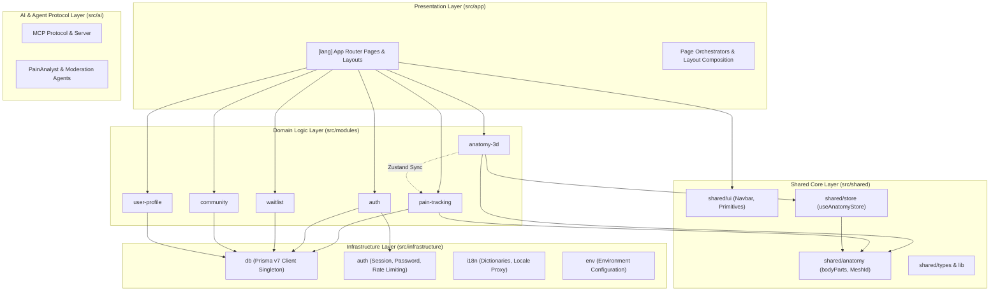
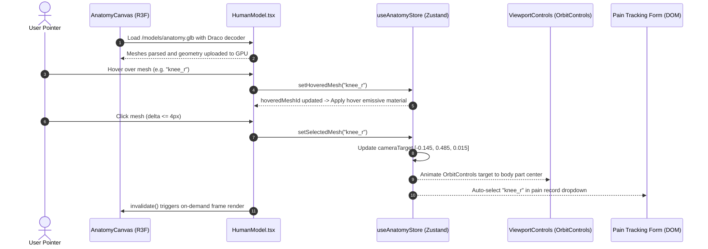
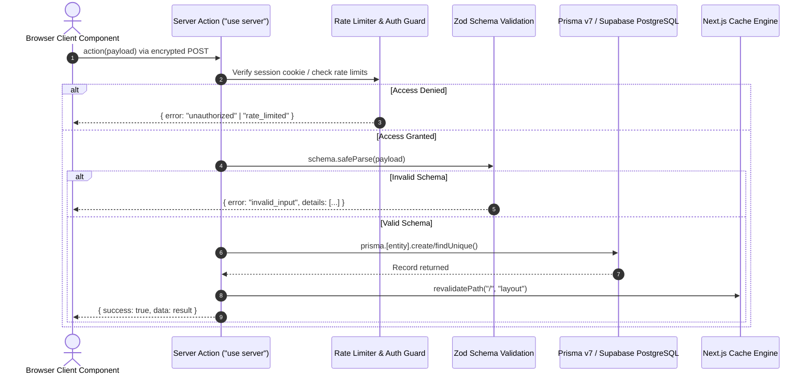

# WITP Architecture Specification

> **System**: What is This Pain? (WITP)  
> **Pattern**: Screaming Architecture / Domain-Driven Design (DDD)  
> **Framework**: Next.js 16 (App Router) & React 19  
> **Graphics Engine**: React Three Fiber 9, Three.js 0.186, Draco Compression  
> **Database & ORM**: PostgreSQL via Prisma ORM v7 with `@prisma/adapter-pg`  
> **State Management**: Zustand 5  
> **Validation**: Zod 4  

---

## Table of Contents

- [Architectural Overview](#architectural-overview)
  - [Screaming Architecture Principles](#screaming-architecture-principles)
  - [High-Level Layer Diagram](#high-level-layer-diagram)
- [Core Layers and Boundaries](#core-layers-and-boundaries)
  - [1. Presentation & Routing: `src/app`](#1-presentation--routing-srcapp)
  - [2. Domain Business Logic: `src/modules`](#2-domain-business-logic-srcmodules)
  - [3. Cross-Cutting & Generic: `src/shared`](#3-cross-cutting--generic-srcshared)
  - [4. Infrastructure & Adapters: `src/infrastructure`](#4-infrastructure--adapters-srcinfrastructure)
  - [5. AI & Agent Protocols: `src/ai`](#5-ai--agent-protocols-srcai)
- [Strict Dependency Rules & Isolation](#strict-dependency-rules--isolation)
  - [Dependency Rule Matrix](#dependency-rule-matrix)
  - [Cross-Domain Communication Protocol](#cross-domain-communication-protocol)
- [3D Rendering Pipeline](#3d-rendering-pipeline)
  - [Graphics Architecture & Technology Stack](#graphics-architecture--technology-stack)
  - [Procedural Model Pipeline & Draco Compression](#procedural-model-pipeline--draco-compression)
  - [The Canonical `meshId` Contract](#the-canonical-meshid-contract)
  - [Raycasting, Mesh Picking, and Material State](#raycasting-mesh-picking-and-material-state)
  - [Zustand Coordination & Reactive Camera Controls](#zustand-coordination--reactive-camera-controls)
  - [On-Demand Rendering & Performance](#on-demand-rendering--performance)
- [Data Flow & RPC Architecture](#data-flow--rpc-architecture)
  - [Next.js Server Actions Model](#nextjs-server-actions-model)
  - [Schema Validation Pipeline (Zod)](#schema-validation-pipeline-zod)
  - [Security Guards & Session Validation](#security-guards--session-validation)
  - [Standardized Response Envelopes](#standardized-response-envelopes)
  - [Cache Revalidation Lifecycle](#cache-revalidation-lifecycle)
- [Project Directory Layout](#project-directory-layout)

---

## Architectural Overview

### Screaming Architecture Principles

**What is This Pain? (WITP)** adheres strictly to **Screaming Architecture**. The codebase structure screams its business domain—physiological pain tracking, anatomical 3D localization, and patient-expert community interaction—rather than the web framework (Next.js) used to deliver it.

Key tenets of this architectural style:
1. **Domain Primacy**: The application's core logic is organized into bounded domains (`src/modules/*`), each containing its own components, actions, schemas, and state.
2. **Thin Orchestrators**: Route handlers and page components in `src/app` act purely as presentation containers and server-side composition layers. They assemble domain components and inject server-rendered context.
3. **Strict Module Isolation**: Domain modules are decoupled and encapsulated. No module may import directly from another module.
4. **Separation of Infrastructure**: Technical mechanisms (Prisma database clients, auth sessions, cryptography, i18n dictionaries) reside in `src/infrastructure` and are consumed by modules and the app router via well-defined boundaries.

### High-Level Layer Diagram



---

## Core Layers and Boundaries

### 1. Presentation & Routing: `src/app`

The `src/app` directory implements the Next.js 16 App Router using dynamic localized routing (`[lang]`):

```
src/app/
├── [lang]/
│   ├── (auth)/             # Route group for authentication screens
│   ├── (community)/        # Route group for community feed and forum
│   ├── (dashboard)/        # Route group for logged-in pain dashboard
│   ├── layout.tsx          # Root localized layout (i18n provider, font loading)
│   └── page.tsx            # Root landing page (3D hero, waitlist capture)
├── favicon.ico
└── globals.css             # Tailwind CSS v4 design tokens and base styles
```

#### Responsibilities & Boundaries:
- **Routing & Route Groups**: Manages URL segments, layouts, search params, and language selection.
- **Server-Side Composition**: Assembles domain components from `src/modules/*` into unified views.
- **Data Hydration**: Fetches read-only initial data on the server and passes props into client module components.
- **Strict Constraint**: Never contains raw SQL, database client instantiations, or business calculation algorithms. Pages must remain thin delegators.

### 2. Domain Business Logic: `src/modules`

Domain logic is compartmentalized into self-contained modules under `src/modules/`:

| Module | Core Responsibility | Key Artifacts |
| :--- | :--- | :--- |
| **`anatomy-3d`** | 3D human model rendering, camera viewport transitions, Draco decompression, shader materials, and raycast picking. | `HumanModel.tsx`, `AnatomyCanvas.tsx`, `AnatomyScene.tsx`, `ViewportControls.tsx`, `generate-model.ts` |
| **`auth`** | User registration, credential verification, cryptographic session management, and auth forms. | `actions.ts` (`authenticate`, `signOut`), `schemas.ts` (`authSchema`), UI forms |
| **`pain-tracking`** | Pain recording (intensity scale 0–10, notes, timestamps), anatomical region mapping, and historical logs. | `actions.ts` (`createPainRecord`, `getPainHistory`), `schemas.ts` (`painRecordSchema`), pain cards |
| **`community`** | Peer interactions, discussion posts, threaded replies, post reactions/likes, and educational medical entries. | `actions.ts` (`createPost`, `createComment`, `toggleLike`), discussion feeds |
| **`user-profile`** | User bios, demographic profiles, notification preferences, and follow graphs. | `actions.ts` (`updateUserProfile`, `toggleFollowUser`), settings panels |
| **`waitlist`** | Pre-launch subscription handling, duplicate email prevention, and landing page notifications. | `actions.ts` (`subscribeToWaitlist`), `schemas.ts` (`waitlistSchema`), signup components |

#### Anatomy of a Domain Module:
Each module encapsulates its full vertical slice:
```
src/modules/[domain]/
├── actions.ts          # Server Actions ("use server") for domain mutations
├── schemas.ts          # Zod validation schemas for input/output contracts
├── components/         # React components specific to this domain
│   ├── [Feature]View.tsx
│   └── [Feature]Card.tsx
├── store/              # (Optional) Domain-local client state
└── ai/                 # (Optional) Domain-specific agent tooling
```

### 3. Cross-Cutting & Generic: `src/shared`

The `src/shared` layer contains reusable primitives and cross-cutting capabilities that do not belong to any single business domain:

- **`src/shared/ui/`**: Domain-agnostic design system primitives (e.g., `Navbar.tsx`, buttons, modals, input fields) built with Tailwind CSS v4 and Lucide icons.
- **`src/shared/store/`**: Cross-cutting Zustand stores. The canonical example is `useAnatomyStore.ts`, which bridges 3D viewport interactions with DOM pain tracking forms.
- **`src/shared/anatomy.ts`**: The single source of truth for anatomical landmarks. Exports `bodyParts` with 3D spatial center coordinates, the `MeshId` union type, and the `isMeshId` type guard.
- **`src/shared/types/`**: Shared TypeScript definitions, utility types, and generic API response shapes.
- **`src/shared/lib/`**: Generic utilities (e.g., formatting, date utilities, math helpers).

### 4. Infrastructure & Adapters: `src/infrastructure`

The `src/infrastructure` directory isolates low-level technical concerns, third-party libraries, and external drivers:

- **`src/infrastructure/db/prisma.ts`**: The Prisma ORM v7 client singleton configured with `@prisma/adapter-pg` driver adapter. Implements connection reuse across hot reloads in development.
- **`src/infrastructure/auth/`**:
  - `session.ts`: Cryptographic token generation (`crypto.randomBytes`), SHA-256 token hashing, session creation, validation against PostgreSQL, and secure cookie configuration.
  - `password.ts`: Secure password hashing using Node.js `crypto.scrypt` with random salt generation and constant-time buffer comparison (`crypto.timingSafeEqual`).
  - `rate-limit.ts`: In-memory sliding-window rate limiter protecting authentication endpoints from brute-force attacks.
- **`src/infrastructure/i18n/`**:
  - `dictionaries.ts`: Server-side loader for JSON locale dictionaries (`en`, `es`).
  - `proxy.ts`: Edge-compatible language negotiation based on `Accept-Language` headers and cookie overrides.
  - `I18nProvider.tsx` & `useTranslation.ts`: Client-side translation context and hook.
- **`src/infrastructure/env/`**: Strongly-typed runtime validation for server and client environment variables.

### 5. AI & Agent Protocols: `src/ai`

The `src/ai` directory encapsulates Model Context Protocol (MCP) server implementation and autonomous agent logic:
- **`mcp/protocol.ts` & `mcp/server.ts`**: Standardized MCP server exposing WITP anatomical data, clinical condition queries, and symptom correlation tools to external LLM agents.
- **`client.ts`**: Central client for interacting with AI models.

---

## Strict Dependency Rules & Isolation

### Dependency Rule Matrix

WITP enforces rigorous architectural boundaries. Violations degrade modularity and are rejected by linting and architectural reviews:

| Importing From \ Allowed Target | `app` | `modules` | `shared` | `infrastructure` | `ai` |
| :--- | :---: | :---: | :---: | :---: | :---: |
| **`app`** | ❌ (sibling only) | ✅ Yes | ✅ Yes | ✅ Yes | ✅ Yes |
| **`modules/[A]`** | ❌ **FORBIDDEN** | ❌ **FORBIDDEN (to [B])** | ✅ Yes | ✅ Yes | ✅ Yes |
| **`shared`** | ❌ **FORBIDDEN** | ❌ **FORBIDDEN** | ❌ (sibling only) | ❌ **FORBIDDEN** | ❌ **FORBIDDEN** |
| **`infrastructure`** | ❌ **FORBIDDEN** | ❌ **FORBIDDEN** | ✅ Types only | ❌ (sibling only) | ❌ **FORBIDDEN** |
| **`ai`** | ❌ **FORBIDDEN** | ❌ **FORBIDDEN** | ✅ Yes | ✅ Yes | ❌ (sibling only) |

#### Cardinal Dependency Rules:
1. **Rule 1: No Upward Imports from `app/`**:
   Files in `modules/`, `shared/`, `infrastructure/`, or `ai/` **must never** import from `app/`. Route-specific state (like URL parameters or query strings) must be passed down as component props or function arguments.
2. **Rule 2: Strict Module Isolation**:
   Modules must never import directly from other modules (e.g., `modules/pain-tracking` cannot import from `modules/anatomy-3d`).
3. **Rule 3: Database Client Encapsulation**:
   Never instantiate `new PrismaClient()` inside domain actions or components. Always import the singleton `prisma` client from `@/infrastructure/db/prisma`.
4. **Rule 4: Colocated Server Actions**:
   Server Actions must live within their respective domain `src/modules/[domain]/actions.ts`. A monolithic global `actions/` folder is prohibited.

### Cross-Domain Communication Protocol

When two business domains need to interact, they communicate via one of two decoupled patterns:

```mermaid
flowchart TD
    subgraph ClientCoordination ["Client-Side Interaction (User Clicks 3D Mesh)"]
        AnatomyComponent["anatomy-3d / HumanModel.tsx"]
        Store["shared/store / useAnatomyStore"]
        PainFormComponent["pain-tracking / PainForm.tsx"]

        AnatomyComponent -->|1. setSelectedMesh('knee_r')| Store
        Store -->|2. Reactive state subscription| PainFormComponent
    end

    subgraph ServerComposition ["Server-Side Composition (Page Loading)"]
        DashboardPage["app/[lang]/(dashboard)/page.tsx"]
        PainModuleAction["pain-tracking / actions.ts (getPainHistory)"]
        ProfileModuleAction["user-profile / actions.ts (getUserProfile)"]

        DashboardPage -->|Fetch pain data| PainModuleAction
        DashboardPage -->|Fetch profile data| ProfileModuleAction
        DashboardPage -->|Compose props| UnifiedView["Dashboard UI Layout"]
    end
```

1. **Client-Side State Coordination**:
   If the user clicks an anatomical mesh rendered by `anatomy-3d`, the component updates `useAnatomyStore.getState().setSelectedMesh(meshId)`. The `pain-tracking` form observes `selectedMeshId` and auto-populates the target body region. Neither module knows about the other.
2. **Server-Side Composition in `src/app`**:
   If a dashboard page needs to display both the user profile and their historical pain records, `src/app/[lang]/(dashboard)/page.tsx` imports `getUserProfile` and `getPainHistory`, fetches the data concurrently on the server, and injects the results into the respective module views.

---

## 3D Rendering Pipeline

### Graphics Architecture & Technology Stack

The 3D interactive human model is powered by:
- **React Three Fiber (R3F) v9.7.0**: Declarative Three.js scene graph management integrated with React 19.
- **@react-three/drei v10.7.8**: Helper primitives including `useGLTF`, `OrbitControls`, and environment presets.
- **Three.js v0.186.0**: WebGL rendering engine.
- **Google Draco Compression**: `KHR_draco_mesh_compression` decompressed on the client via WebAssembly (`/draco/draco_decoder.wasm`).



### Procedural Model Pipeline & Draco Compression

Rather than loading bulky uncompressed assets, WITP generates an optimized, stylized procedural anatomical GLTF model via `src/modules/anatomy-3d/generate-model.ts`:

1. **Geometry Synthesis**:
   - Uses Three.js curves (`CatmullRomCurve3`), contours, and `BufferGeometry` to sculpt 32 discrete anatomical regions (head, cervical spine, chest, abdomen, lumbar spine, pelvis, extremities, and joints).
   - Adjacent regions share boundary loops to ensure a smooth, continuous human silhouette.
2. **Asset Packaging & Draco Compression**:
   - Processes the geometry through `@gltf-transform/core` and `@gltf-transform/extensions`.
   - Compresses vertex coordinates, normals, and indices using `draco3dgltf` into Google Draco format.
   - Outputs the final binary asset to `public/models/anatomy.glb` (under 2 MB, compressed from raw geometries).
   - Copies WASM decoder binaries to `public/draco/draco_decoder.wasm` for client-side multi-threaded decoding.

### The Canonical `meshId` Contract

A strict string-identifier contract links all WITP subsystems:

$$\text{MeshId} \in \{\text{"head"}, \text{"cervical\_spine"}, \text{"chest\_l"}, \dots, \text{"foot\_r"}\}$$

Defined in `src/shared/anatomy.ts`:

```typescript
export const bodyParts = [
  { meshId: "head", center: [0, 1.72, 0] },
  { meshId: "cervical_spine", center: [0, 1.51, 0] },
  { meshId: "chest_l", center: [0.14, 1.35, 0.055] },
  { meshId: "chest_r", center: [-0.14, 1.35, 0.055] },
  // ... 32 total anatomical landmarks
] as const;

export type MeshId = (typeof bodyParts)[number]["meshId"];
```

This identifier contract guarantees cohesion across:
1. **GLTF 3D Nodes**: Each mesh node in `anatomy.glb` has its `name` attribute set to `meshId`.
2. **PostgreSQL Database**: The `BodyPart` model stores `meshId String @unique`.
3. **Database Seeding**: `prisma/seed.ts` upserts canonical regions matching `bodyParts`.
4. **i18n Localization**: Translated body region names in `src/infrastructure/i18n/dictionaries/{lang}/anatomy.json`.
5. **Zod Validation**: `painRecordSchema` verifies that incoming pain submissions match an active `meshId`.

### Raycasting, Mesh Picking, and Material State

Inside `HumanModel.tsx`, mesh picking is handled with precision:

- **Pointer Events**:
  - `onPointerOver`: Triggers `hover(meshId)`. Stops event propagation to prevent background meshes from triggering.
  - `onPointerOut`: Clears hover state if the hovered mesh matches.
  - `onClick`: Validates `event.delta <= 4`. If the user dragged more than 4 pixels (rotating the camera), the click is ignored. If $\le 4$ px, `select(meshId)` is invoked.
- **Dynamic Shading**:
  Meshes render using `meshStandardMaterial` with real-time responsive parameters:

| Visual State | Color | Emissive Color | Emissive Intensity | Roughness / Metalness |
| :--- | :--- | :--- | :--- | :--- |
| **Default / Inactive** | `#b4c9c7` (Subtle teal-gray) | `#000000` (None) | `0.0` | `0.43` / `0.18` |
| **Hovered** | `#b6eadf` (Soft mint highlight) | `#40bc9a` | `0.22` | `0.43` / `0.18` |
| **Selected / Active** | `#7ce9cc` (Vibrant cyan-teal) | `#40bc9a` | `0.55` | `0.43` / `0.18` |

### Zustand Coordination & Reactive Camera Controls

The `useAnatomyStore` store coordinates 3D and DOM state:

```typescript
type AnatomyState = {
  selectedMeshId: string | null;
  hoveredMeshId: string | null;
  cameraTarget: [number, number, number] | null;
  setSelectedMesh: (id: string | null) => void;
  setHoveredMesh: (id: string | null) => void;
  setCameraTarget: (target: [number, number, number] | null) => void;
  resetSelection: () => void;
};
```

When `setSelectedMesh("knee_r")` is called:
1. `selectedMeshId` updates to `"knee_r"`.
2. `cameraTarget` is calculated from the body part's 3D spatial center `[-0.145, 0.485, 0.015]`.
3. `ViewportControls.tsx` observes `cameraTarget` and smoothly interpolates the camera pivot using GSAP / OrbitControls damping.
4. DOM panels (e.g. pain severity selector, recent pain cards) highlight the chosen part.

### On-Demand Rendering & Performance

To preserve mobile battery life and eliminate unnecessary GPU cycles:
- **`frameloop="demand"`**: The R3F canvas does not run an unconstrained 60/120 FPS render loop when idle.
- **Explicit Invalidation**: Any user interaction (hover, selection, or camera manipulation) invokes `useThree().invalidate()` to re-render the frame on demand.
- **Memory Management**: Geometries and textures are cached by Drei's `useGLTF` hook, preventing memory leaks during route changes.

---

## Data Flow & RPC Architecture

### Next.js Server Actions Model

WITP rejects generic, weakly-typed REST routes (`/api/*`) in favor of **Next.js Server Actions** (`"use server"`). Server actions serve as direct Remote Procedure Calls (RPC):



### Schema Validation Pipeline (Zod)

Every action strictly validates incoming arguments at runtime using Zod 4:

```typescript
// Example: src/modules/pain-tracking/schemas.ts
export const painRecordSchema = z.object({
  meshId: z.string().refine(isMeshId, "Invalid anatomical mesh region"),
  intensity: z.number().int().min(1).max(10),
  notes: z.string().trim().max(2000).optional(),
  recordedAt: z.string().regex(/^\d{4}-\d{2}-\d{2}$/, "Must be YYYY-MM-DD"),
});
```

Benefits:
- **Zero Raw Input Penetration**: Malformed or malicious payloads are halted before touching database layers.
- **Automatic Type Inference**: Frontend forms and backend actions share identical TypeScript types via `z.infer<typeof schema>`.

### Security Guards & Session Validation

Authentication is validated using secure cryptographic primitives:
1. **Cookie Transport**: The session token resides in an `HttpOnly`, `Secure` (production), `SameSite=Lax` cookie named `witp-session`.
2. **Database Verification**: Server Actions invoke `getSessionUser()`:
   - Reads the cookie token.
   - Calculates `tokenHash = crypto.createHash("sha256").update(token).digest("hex")`.
   - Queries `prisma.session.findUnique()` with expiration check (`expiresAt > new Date()`).
   - Ensures associated `User.status === 'ACTIVE'`.
3. **Rate Limiting**: Mutation actions prone to abuse (e.g. login attempts) call `allowAuthAttempt(email)` to reject requests exceeding the sliding window (max 8 attempts per 15 minutes).

### Standardized Response Envelopes

All Server Actions return a discriminated union:

```typescript
export type ActionResult<T> =
  | { success: true; data: T }
  | { error: string; details?: unknown };
```

This prevents unhandled runtime exceptions from leaking sensitive server traces to the client and forces client components to explicitly handle both error and success states.

### Cache Revalidation Lifecycle

When an action mutates state (such as recording new pain or signing out):
1. The mutation commits to PostgreSQL.
2. The action calls Next.js `revalidatePath`:
   ```typescript
   revalidatePath("/[lang]/dashboard", "page");
   ```
3. Next.js re-renders affected Server Components in the background and delivers updated payloads to the client without requiring a full browser reload.

---

## Project Directory Layout

```
/home/ttrotta/orca/witp/
├── docs/                           # Canonical technical documentation
│   ├── ARCHITECTURE.md             # This document: Screaming Architecture & 3D specification
│   ├── API.md                      # Complete Server Actions RPC contracts & security matrix
│   ├── DATABASE.md                 # Prisma v7, Supabase dual-connection, migrations & pooling
│   ├── DEPLOYMENT.md               # Vercel App Router, build pipeline, envs, production checklist
│   ├── GIT_WORKFLOW.md             # Conventional commits, branching model, PR verification
│   ├── database/
│   │   └── SCHEMA.md               # Authoritative database model reference & DDL
│   └── memory/
│       └── 2026-10.md              # Monthly chronological architecture log & context
├── prisma/
│   ├── migrations/                 # PostgreSQL migration SQL files
│   ├── schema.prisma               # Prisma data models and relations
│   └── seed.ts                     # Database seeder (anatomical landmarks, test users)
├── public/
│   ├── draco/                      # Draco WebAssembly decoder binaries
│   └── models/
│       └── anatomy.glb             # Draco-compressed 3D human model asset
├── src/
│   ├── ai/                         # AI integrations and Model Context Protocol (MCP) server
│   ├── app/                        # Next.js App Router ([lang] routes, layouts, pages)
│   ├── infrastructure/             # DB (Prisma), Auth (Sessions, Crypto), i18n, Env
│   ├── modules/                    # Domain modules (anatomy-3d, pain-tracking, auth, etc.)
│   ├── shared/                     # Shared UI primitives, useAnatomyStore, anatomy contract
│   └── proxy.ts                    # Edge language proxy / negotiator
├── prisma.config.ts                # Prisma ORM v7 configuration (defineConfig)
├── package.json                    # Project dependencies, scripts, packageManager
├── tsconfig.json                   # Strict TypeScript path aliases (@/*, @generated/*)
└── witp.test.ts                    # Node test runner suite validating 3D and security contracts
```
