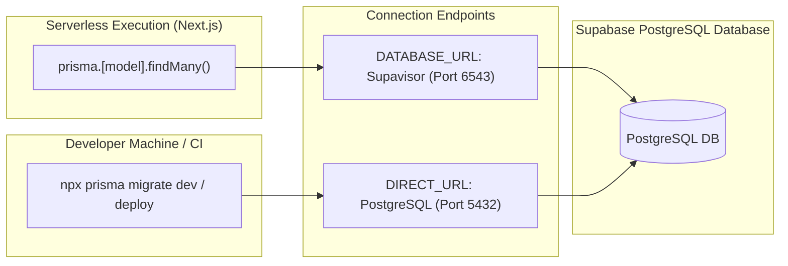

# Database Architecture & Supabase Operations

> **ORM Engine**: Prisma ORM v7 (`@prisma/client` 7.4.2, `prisma` 7.4.2)  
> **Driver Adapter**: `@prisma/adapter-pg` with `pg` (node-postgres)  
> **Database Provider**: Managed PostgreSQL 15+ hosted on Supabase  
> **Client Output**: Custom location at `../generated/prisma` (`@generated/prisma/client`)  
> **Configuration Mechanism**: `prisma.config.ts` (Prisma v7 `defineConfig`)  

---

## Table of Contents

- [Architectural Overview](#architectural-overview)
  - [Prisma ORM v7 Architectural Shift](#prisma-orm-v7-architectural-shift)
  - [High-Level Database Topology](#high-level-database-topology)
- [Prisma v7 Configuration & Client Architecture](#prisma-v7-configuration--client-architecture)
  - [Prisma Config: `prisma.config.ts`](#prisma-config-prismaconfigts)
  - [Schema Definition: `prisma/schema.prisma`](#schema-definition-prismaschemaprisma)
  - [Client Instantiation Singleton: `src/infrastructure/db/prisma.ts`](#client-instantiation-singleton-srcinfrastructuredbprismats)
- [Supabase Dual-Connection Architecture](#supabase-dual-connection-architecture)
  - [Why Dual Connections Are Mandatory](#why-dual-connections-are-mandatory)
  - [1. Runtime Connection: `DATABASE_URL` (Supavisor Pooler, Port 6543)](#1-runtime-connection-database_url-supavisor-pooler-port-6543)
  - [2. Migration Connection: `DIRECT_URL` (Direct Postgres, Port 5432)](#2-migration-connection-direct_url-direct-postgres-port-5432)
  - [Connection String Format Comparison](#connection-string-format-comparison)
- [Supabase Connection Gotchas & Troubleshooting](#supabase-connection-gotchas--troubleshooting)
  - [1. Mandatory SSL Configuration (`sslmode=require`)](#1-mandatory-ssl-configuration-sslmoderequire)
  - [2. Connection Timeouts & Serverless Pool Limits](#2-connection-timeouts--serverless-pool-limits)
  - [3. IPv4 vs. IPv6 Compatibility](#3-ipv4-vs-ipv6-compatibility)
  - [4. Transaction Pooler Prepared Statements](#4-transaction-pooler-prepared-statements)
- [Database CLI Operations & Workflows](#database-cli-operations--workflows)
  - [Development Migrations: `prisma migrate dev`](#development-migrations-prisma-migrate-dev)
  - [Production Migrations: `prisma migrate deploy`](#production-migrations-prisma-migrate-deploy)
  - [Schema Prototyping: `prisma db push`](#schema-prototyping-prisma-db-push)
  - [Database Seeding: `pnpm db:seed`](#database-seeding-pnpm-dbseed)
  - [Interactive Data Management: `prisma studio`](#interactive-data-management-prisma-studio)
  - [Client Regeneration: `prisma generate`](#client-regeneration-prisma-generate)

---

## Architectural Overview

### Prisma ORM v7 Architectural Shift

Prisma ORM v7 introduces several architectural differences compared to prior major versions (v5/v6):

1. **Decoupled Datasource Configuration**:
   Connection strings and migration options are no longer specified using `url = env("DATABASE_URL")` within `prisma/schema.prisma`. Instead, they are defined in a root-level TypeScript configuration file: `prisma.config.ts`.
2. **Mandatory Driver Adapters**:
   Prisma ORM 7 leverages the query compiler engine by default, requiring a JavaScript/TypeScript database driver adapter (`@prisma/adapter-pg` paired with `pg`) rather than relying exclusively on a native binary query engine.
3. **Explicit Client Output Path**:
   The generator block requires an explicit output directory (in WITP: `../generated/prisma`), referenced in TypeScript via the alias `@generated/*`.

### High-Level Database Topology

```mermaid
graph TD
    subgraph AppServer ["Next.js App Router (Server Actions & Server Components)"]
        Singleton["prisma Client Singleton (src/infrastructure/db/prisma.ts)"]
        Adapter["@prisma/adapter-pg (PrismaPg Adapter)"]
        Driver["node-postgres ('pg' Pool)"]
        Singleton --> Adapter --> Driver
    end

    subgraph SupabaseInfra ["Supabase Cloud Infrastructure"]
        Supavisor["Supavisor Connection Pooler (Port 6543, Transaction Mode)"]
        DirectPostgres["Direct PostgreSQL Instance (Port 5432)"]
    end

    Driver -->|Runtime Queries (DATABASE_URL)| Supavisor
    Supavisor -->|Managed Internal Connections| DirectPostgres

    CLI["Prisma CLI (Migrations & Seed)"] -->|DDL & Migrations (DIRECT_URL)| DirectPostgres
```

---

## Prisma v7 Configuration & Client Architecture

### Prisma Config: `prisma.config.ts`

Located at the repository root, `prisma.config.ts` controls Prisma CLI behaviors, migration locations, seeder execution, and datasource routing:

```typescript
import "dotenv/config";
import { defineConfig } from "prisma/config";

export default defineConfig({
  schema: "prisma/schema.prisma",
  migrations: {
    path: "prisma/migrations",
    seed: "tsx prisma/seed.ts",
  },
  datasource: {
    // Falls back to DATABASE_URL if DIRECT_URL is omitted (e.g. in local development)
    url: process.env["DIRECT_URL"] ?? process.env["DATABASE_URL"],
  },
});
```

#### Key Architecture Nuance:
During CLI operations (such as running `npx prisma migrate dev`), the CLI reads `datasource.url` from `prisma.config.ts`. It prioritizes `DIRECT_URL` to connect directly to PostgreSQL on port 5432, bypassing transaction connection poolers that reject DDL locks.

### Schema Definition: `prisma/schema.prisma`

The schema file contains purely structural data modeling:

```prisma
generator client {
  provider = "prisma-client"
  output   = "../generated/prisma"
}

datasource db {
  provider = "postgresql"
}

// Model definitions follow (User, Session, BodyPart, PainRecord, etc.)
```

Notice that `datasource db` only specifies `provider = "postgresql"`. All environment variable resolution and network routing logic is handled by `prisma.config.ts` and the driver adapter.

### Client Instantiation Singleton: `src/infrastructure/db/prisma.ts`

To maintain performance and avoid connection pool exhaustion during development hot-reloading:

```typescript
import "dotenv/config";
import { PrismaPg } from "@prisma/adapter-pg";
import { PrismaClient } from "@generated/prisma/client";

const globalForPrisma = globalThis as unknown as { prisma?: PrismaClient };

const prisma =
  globalForPrisma.prisma ??
  new PrismaClient({
    adapter: new PrismaPg({
      connectionString: process.env.DATABASE_URL,
      connectionTimeoutMillis: 5000,
    }),
  });

if (process.env.NODE_ENV !== "production") globalForPrisma.prisma = prisma;

export { prisma };
```

#### Implementation Highlights:
1. **Driver Adapter Integration**: `new PrismaPg({ connectionString: process.env.DATABASE_URL })` bridges Prisma with the standard `pg` connection pool.
2. **Connection Timeout**: `connectionTimeoutMillis: 5000` ensures that slow network handshakes fail fast rather than hanging serverless invocations.
3. **Global Singleton Cache**: Caches the client instance on `globalThis` in development. Without this, every Next.js hot module reload would instantiate a new `PrismaClient` with fresh connection pools, rapidly exhausting the database connection limit.

---

## Supabase Dual-Connection Architecture

### Why Dual Connections Are Mandatory

Next.js Server Actions execute in ephemeral serverless functions. This architecture creates a fundamental tension:
- **Serverless functions require high-volume pooling**: Hundreds of concurrent lambdas executing queries would immediately exceed PostgreSQL's direct connection limits.
- **Prisma migrations require direct access**: Migrations rely on PostgreSQL advisory locks (`pg_advisory_lock`) and session-level DDL features that transaction poolers do not support.

To solve this, WITP uses two distinct database URLs:



### 1. Runtime Connection: `DATABASE_URL` (Supavisor Pooler, Port 6543)

- **Purpose**: All application runtime database queries executed by Server Actions and Server Components.
- **Port**: `6543`.
- **Mode**: Transaction Pooling (Supavisor).
- **Behavior**: Connections are allocated to clients only for the duration of a single transaction and returned to the pool immediately upon completion.
- **Required Query Parameter**: `?pgbouncer=true` must be appended to the connection string to inform Prisma that prepared statements are transaction-scoped.

### 2. Migration Connection: `DIRECT_URL` (Direct Postgres, Port 5432)

- **Purpose**: Schema migrations (`prisma migrate dev`, `prisma migrate deploy`), introspection (`prisma db pull`), and schema seeding.
- **Port**: `5432`.
- **Mode**: Direct PostgreSQL connection.
- **Behavior**: Holds an unbroken, stateful session with full support for advisory locks, schema alteration commands, and custom PostgreSQL extensions (`gen_random_uuid()`).

### Connection String Format Comparison

| Parameter | `DATABASE_URL` (Runtime Pooler) | `DIRECT_URL` (Migrations & Direct) |
| :--- | :--- | :--- |
| **Hostname** | `aws-0-[region].pooler.supabase.com` | `db.[project-ref].supabase.co` |
| **Port** | **`6543`** | **`5432`** |
| **User Format** | `postgres.[project-ref]` | `postgres` |
| **Parameters** | `?sslmode=require&pgbouncer=true` | `?sslmode=require` |
| **Used By** | `src/infrastructure/db/prisma.ts` | `prisma.config.ts` (CLI commands) |

---

## Supabase Connection Gotchas & Troubleshooting

### 1. Mandatory SSL Configuration (`sslmode=require`)

Supabase cloud PostgreSQL instances reject unencrypted plaintext connections.

> [!CAUTION]
> If `?sslmode=require` is missing from either `DATABASE_URL` or `DIRECT_URL`, the connection will be dropped during the TLS handshake, resulting in:
> `Error: connection closed unexpectedly` or `self-signed certificate in certificate chain`.

**Always ensure**:
```
DATABASE_URL="postgresql://...:6543/postgres?sslmode=require&pgbouncer=true"
DIRECT_URL="postgresql://...:5432/postgres?sslmode=require"
```

### 2. Connection Timeouts & Serverless Pool Limits

In serverless environments, cold starts or network latency can cause connections to time out if not configured properly:
- In `src/infrastructure/db/prisma.ts`, `connectionTimeoutMillis` is explicitly capped at `5000` ms.
- If you encounter `P1001: Can't reach database server at ...:6543`, check Supabase **Project Settings > Database > Connection Pooling** to verify that the pool size is sufficient for your serverless traffic.

### 3. IPv4 vs. IPv6 Compatibility

- **The Problem**: Newer Supabase projects use IPv6 addresses by default for direct connections (`db.[project-ref].supabase.co`). Certain local ISPs, Docker environments, and cloud CI runners lack IPv6 routing and will fail to resolve the hostname.
- **The Solution**:
  - The Supavisor pooler hostname (`pooler.supabase.com`) supports dual IPv4 and IPv6 resolution.
  - If `DIRECT_URL` cannot connect due to IPv6 routing issues, enable the **IPv4 Add-on** in the Supabase Dashboard, or run migrations through an IPv6-compatible runner (e.g. modern GitHub Actions runners).

### 4. Transaction Pooler Prepared Statements

In transaction pooling mode (Supavisor port 6543), client connections are rotated between transactions. As a result:
- Server-side prepared statements cannot be reused across transactions.
- Always include `pgbouncer=true` in `DATABASE_URL`. This instructs the query compiler to avoid session-level prepared statement caching that causes `prepared statement "s0" does not exist` errors.

---

## Database CLI Operations & Workflows

### Development Migrations: `prisma migrate dev`

When you modify `prisma/schema.prisma` in local development:

```bash
npx prisma migrate dev --name <descriptive_migration_name>
```

**What this command does**:
1. Connects to the database via `DIRECT_URL` (port 5432).
2. Computes the diff between `schema.prisma` and the database state.
3. Generates a new SQL migration file in `prisma/migrations/<timestamp>_<name>/migration.sql`.
4. Executes the migration against the local/development database.
5. Runs `prisma generate` to update the TypeScript client at `generated/prisma`.

### Production Migrations: `prisma migrate deploy`

Used in automated CI/CD deployment pipelines:

```bash
npx prisma migrate deploy
```

**Characteristics**:
- Non-interactive and deterministic.
- Does not generate new migration files.
- Reads existing SQL files from `prisma/migrations` and executes any that have not yet been applied.
- Uses `DIRECT_URL` to acquire the necessary PostgreSQL advisory locks.

### Schema Prototyping: `prisma db push`

For rapid local experimentation without creating persistent migration files:

```bash
npx prisma db push
```

> [!WARNING]
> Use `prisma db push` only for rapid local prototyping. Never use it in production environments, as it does not track migration history and can result in unrecoverable data loss.

### Database Seeding: `pnpm db:seed`

WITP provides an automated seeding script in `prisma/seed.ts`:

```bash
pnpm db:seed
```

*Invokes: `prisma db seed`, which executes `tsx prisma/seed.ts` via `prisma.config.ts`.*

#### Seeder Functionality:
- Upserts the 32 canonical anatomical landmarks into the `BodyPart` table.
- Reads localized names from `src/infrastructure/i18n/dictionaries/en/anatomy.json`.
- Guarantees that every `meshId` referenced by the 3D model exists in the database.

### Interactive Data Management: `prisma studio`

To inspect, filter, and edit records in a local browser interface:

```bash
npx prisma studio
```

Opens a visual database explorer at `http://localhost:5555`.

### Client Regeneration: `prisma generate`

If TypeScript types or client definitions are out of sync:

```bash
npx prisma generate
```

Compiles the latest Prisma Client into `./generated/prisma`. This command is executed automatically during `pnpm build` and `pnpm postinstall`.
