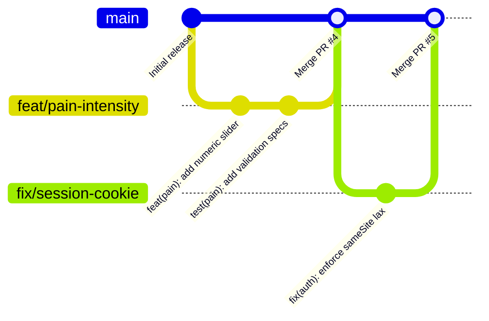
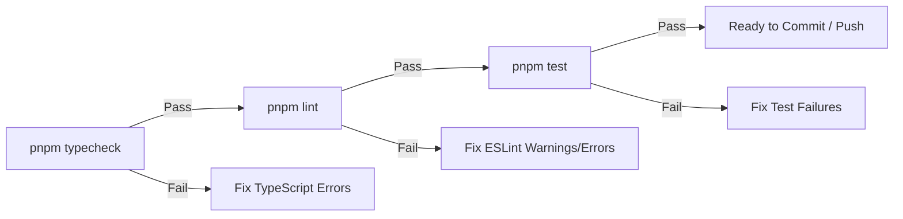

# Git Workflow & Commit Guidelines

> **Standard**: Conventional Commits 1.0.0  
> **Target Branch**: `main` (Production Stable)  
> **Branch Strategy**: Short-Lived Feature Branches (`feat/*`, `fix/*`, `chore/*`)  
> **Quality Gate**: Mandatory local & CI verification (`typecheck`, `lint`, `test`)  

---

## Table of Contents

- [Core Principles](#core-principles)
- [Conventional Commits Specification](#conventional-commits-specification)
  - [Commit Structure](#commit-structure)
  - [Allowed Commit Types](#allowed-commit-types)
  - [Domain Scopes](#domain-scopes)
  - [Summary & Body Formatting](#summary--body-formatting)
  - [Breaking Changes](#breaking-changes)
- [Strict Repository Rules](#strict-repository-rules)
  - [Zero AI Attribution / No Co-Authored-By](#zero-ai-attribution--no-co-authored-by)
  - [Atomic & Logical Commits](#atomic--logical-commits)
  - [No Secret or Artifact Leaks](#no-secret-or-artifact-leaks)
- [Branching Model](#branching-model)
  - [Main Branch Policy](#main-branch-policy)
  - [Feature & Topic Branching](#feature--topic-branching)
- [Pre-Commit & Verification Pipeline](#pre-commit--verification-pipeline)
  - [1. Type Safety Check](#1-type-safety-check)
  - [2. Code Linting](#2-code-linting)
  - [3. Test Suite Execution](#3-test-suite-execution)
  - [4. Build Smoke Test](#4-build-smoke-test)
- [Pull Request & Merge Standard](#pull-request--merge-standard)
  - [PR Lifecycle & Description Template](#pr-lifecycle--description-template)
  - [Merge Strategy](#merge-strategy)

---

## Core Principles

The WITP git workflow ensures a clean, deterministic, and bisectable commit log. By adhering strictly to Conventional Commits and rigorous pre-merge validation, the team maintains:
- Automated semantic versioning and changelog generation.
- Rapid root-cause analysis during git bisect operations.
- Total transparency of domain impacts across features and architectural layers.

---

## Conventional Commits Specification

### Commit Structure

Every commit message must follow this exact structural format:

```
<type>[optional scope]: <description>

[optional body]

[optional footer(s)]
```

Example:
```
feat(pain-tracking): add severity slider and anatomical mesh binding

Connect the 0-10 numeric pain intensity selector to the selected 
meshId in the Zustand store, enabling instant visual feedback.

Closes #42
```

### Allowed Commit Types

| Type | Purpose | Production Impact |
| :--- | :--- | :---: |
| **`feat`** | Introduces a new feature or user-facing domain capability. | Yes |
| **`fix`** | Patches a bug or resolves an unexpected defect. | Yes |
| **`docs`** | Updates or creates documentation, specifications, or diagrams. | No |
| **`chore`** | Maintenance tasks, tooling updates, dependency bumps, or config changes. | No |
| **`perf`** | Performance optimizations (e.g. Draco mesh compression, bundle reduction). | Yes |
| **`refactor`** | Code restructure that neither fixes a defect nor adds new functionality. | No |
| **`style`** | Code style adjustments (white-space, formatting, semicolons). | No |
| **`test`** | Adds missing tests, updates assertions, or refactors test harnesses. | No |

### Domain Scopes

Scopes are optional but strongly encouraged. When specified, scopes must correspond to Screaming Architecture domain boundaries or core layers:

| Scope | Affected Domain / Subsystem |
| :--- | :--- |
| **`auth`** | Session cookies, password hashing (`scrypt`), rate limiting, registration/login. |
| **`db`** | Prisma schema, PostgreSQL migrations, seeding scripts, database adapters. |
| **`anatomy`** | 3D human model generation, R3F canvas, Drei loaders, Draco compression, mesh coordinates. |
| **`pain`** | Pain record creation, history query, intensity tracking, clinical logs. |
| **`ui`** | Shared design system primitives (`shared/ui`), Tailwind CSS tokens, navigation bar. |
| **`community`** | Discussion posts, threaded comments, reactions, educational medical blog entries. |
| **`profile`** | User profile preferences, biography, avatars, follow graph. |
| **`waitlist`** | Email capture form, pre-launch subscription server action. |
| **`i18n`** | Translation dictionaries (`en`, `es`), locale proxy, language negotiation. |
| **`ai`** | Model Context Protocol (MCP) server, agent tools, LLM prompts. |

### Summary & Body Formatting

1. **Imperative Mood**: Use imperative, present-tense verbs:
   - ✅ `feat(anatomy): implement hover emissive highlighting`
   - ❌ `feat(anatomy): implemented hover emissive highlighting`
   - ❌ `feat(anatomy): implements hover emissive highlighting`
2. **Lowercase Header**: Do not capitalize the first letter of the description.
3. **No Trailing Period**: Do not end the subject line with a period.
4. **Length Limit**: The subject line must not exceed 72 characters.
5. **Body Justification**: If the context or rationale is not self-evident, explain *why* the change was made in the commit body (wrapped at 72 characters).

### Breaking Changes

Breaking changes must be denoted in one of two ways:
1. Append an exclamation mark (`!`) before the colon:
   ```
   feat(auth)!: replace legacy token header with encrypted session cookie
   ```
2. Include a footer starting with `BREAKING CHANGE:`:
   ```
   BREAKING CHANGE: The `bodyPartId` field in `painRecordSchema` has been renamed to `meshId`.
   ```

---

## Strict Repository Rules

### Zero AI Attribution / No Co-Authored-By

> [!CAUTION]
> **STRICT REPOSITORY POLICY: NO AI ATTRIBUTION**
> 
> Under no circumstances may commits include AI attribution trailers, co-author tags, or generative assistant references:
> - ❌ `Co-Authored-By: Claude <claude@anthropic.com>`
> - ❌ `Co-Authored-By: ChatGPT <chatgpt@openai.com>`
> - ❌ `Generated with Claude Code / Cursor / Copilot`
> - ❌ `Assisted-by: AI Assistant`
>
> Pull requests containing commits with AI-related trailers or automated signatures fail the `CI` workflow (`.github/workflows/ci.yml`). All commit messages must reflect pure technical intent and adhere strictly to Conventional Commits.

### Atomic & Logical Commits

- Each commit must represent a single, focused, logical change.
- Never bundle unrelated tasks (e.g. fixing an auth bug while restructuring 3D shaders in the same commit).
- A commit should never leave the repository in a broken or non-compiling state.

### No Secret or Artifact Leaks

- Never commit environment files (`.env`, `.env.local`, `.env.production`). Only `.env.example` with sanitized placeholders is allowed in version control.
- Generated client artifacts under `generated/prisma` are ignored by git and must be generated during build time.
- Heavy uncompressed 3D assets must not be added to `public/models/`. Only Draco-compressed `.glb` assets produced by `pnpm model:generate` are permitted.

---

## Branching Model



### Main Branch Policy

- `main` represents the stable, continuously deployable state of WITP.
- Direct pushes to `main` are restricted in production environments; all changes must arrive via verified Pull Requests.
- The `main` branch must always pass:
  1. `pnpm typecheck`
  2. `pnpm lint`
  3. `pnpm test`
  4. `pnpm build`

### Feature & Topic Branching

Create short-lived branches branching off the latest `main`:

| Branch Prefix | Format | Example |
| :--- | :--- | :--- |
| **`feat/*`** | `feat/<short-description>` | `feat/pain-intensity-slider` |
| **`fix/*`** | `fix/<short-description>` | `fix/session-expiry-drift` |
| **`chore/*`** | `chore/<short-description>` | `chore/upgrade-prisma-7` |
| **`docs/*`** | `docs/<short-description>` | `docs/architecture-guide` |
| **`perf/*`** | `perf/<short-description>` | `perf/draco-mesh-compression` |

Branch names must use all-lowercase alphanumeric characters separated by hyphens (kebab-case).

---

## Pre-Commit & Verification Pipeline

Before staging files or creating a pull request, run the following three quality checks locally. All three must succeed with zero errors. The `CI` GitHub Actions workflow repeats them on every pull request and on pushes to `main`, and also runs `pnpm build`. Make it a required status check in the branch protection settings for `main`.



### 1. Type Safety Check

Validates strict TypeScript types across all layers without generating output files:

```bash
pnpm typecheck
```
*Under the hood: `tsc --noEmit` using project `tsconfig.json`.*

### 2. Code Linting

Enforces Next.js App Router rules, React 19 compiler guidelines, and ESLint configs:

```bash
pnpm lint
```
*Under the hood: `eslint` across the repository, including the layer boundary rules in `eslint.config.mjs`.*

### 3. Test Suite Execution

Executes the Node.js test runner validating Draco asset decompression, Zod boundaries, password hashing, rate limits, and the locale proxy matcher:

```bash
pnpm test
```
*Under the hood: `tsx --test witp.test.ts`.*

### 4. Build Smoke Test (Optional but recommended before large PRs)

Ensures that Next.js App Router server components compile and generate cleanly:

```bash
pnpm build
```
*Under the hood: `prisma generate && next build`.*

---

## Pull Request & Merge Standard

### PR Lifecycle & Description Template

When submitting a pull request, use this canonical template:

```markdown
## Summary
Concise 1-2 sentence overview of the change.

## Motivation & Domain Context
Why is this change necessary? Which module (`src/modules/*`) or architectural layer is affected?

## Key Changes
- List key modifications
- Mention schemas, components, or actions created

## Verification Steps
- [ ] Ran `pnpm typecheck` (0 errors)
- [ ] Ran `pnpm lint` (0 warnings/errors)
- [ ] Ran `pnpm test` (all tests passing)
- [ ] Verified manually in browser
```

### Merge Strategy

- **Squash and Merge**: Preferred for feature branches to keep `main` history linear and clean. The squashed commit message must adhere to the Conventional Commits format.
- **Rebase and Merge**: Permitted when a multi-commit feature branch consists of cleanly separated, atomic Conventional Commits.
- **Merge Commits**: Disallowed for regular feature merges to prevent cluttered non-linear graphs.
