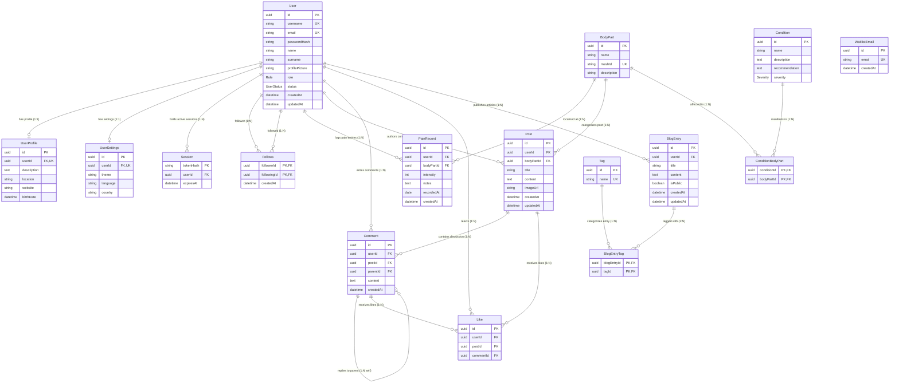

# Database Schema Reference

> **Authoritative Specification**
> **ORM Engine**: Prisma v6 with PostgreSQL (`provider = "postgresql"`)
> **Generated Client**: `@/infrastructure/db/prisma` (Target: `../generated/prisma`)
> **Primary Key Standard**: Native PostgreSQL UUIDv4 (`gen_random_uuid()`)
> **Referential Integrity**: Strict Cascading Deletes (`onDelete: Cascade`, `onUpdate: Cascade`) across all relational hierarchies.

---

## Table of Contents

- [Architectural Overview](#architectural-overview)
  - [UUIDv4 Strategy](#uuidv4-strategy)
  - [Cascading Referential Actions](#cascading-referential-actions)
  - [Indexing and Performance Strategy](#indexing-and-performance-strategy)
  - [Anatomical Mesh Integration](#anatomical-mesh-integration)
- [Entity-Relationship Diagram](#entity-relationship-diagram)
- [Enumerations](#enumerations)
  - [Role](#role)
  - [Severity](#severity)
  - [UserStatus](#userstatus)
- [Model Specifications](#model-specifications)
  - [1. User](#1-user)
  - [2. UserProfile](#2-userprofile)
  - [3. Session](#3-session)
  - [4. UserSettings](#4-usersettings)
  - [5. Follows](#5-follows)
  - [6. BodyPart](#6-bodypart)
  - [7. Condition](#7-condition)
  - [8. ConditionBodyPart](#8-conditionbodypart)
  - [9. PainRecord](#9-painrecord)
  - [10. Post](#10-post)
  - [11. Comment](#11-comment)
  - [12. Like](#12-like)
  - [13. BlogEntry](#13-blogentry)
  - [14. BlogEntryTag](#14-blogentrytag)
  - [15. Tag](#15-tag)
  - [16. WaitlistEmail](#16-waitlistemail)
- [Migration History and DDL Extensions](#migration-history-and-ddl-extensions)

---

## Architectural Overview

The **What is This Pain? (WITP)** database schema models a domain where physiological pain mapping, 3D anatomical localization, clinical condition references, user community interactions, and identity management intersect.

```
+-----------------------------------------------------------------------------------+
|                                  WITP Domains                                     |
+---------------------+-------------------------------+-----------------------------+
| Identity & Settings | Anatomy & Clinical Knowledge  | Pain Journal & Community    |
| - User              | - BodyPart (3D meshId link)   | - PainRecord                |
| - UserProfile       | - Condition                   | - Post                      |
| - UserSettings      | - ConditionBodyPart (Junction)| - Comment (Threaded replies)|
| - Session (SHA-256) |                               | - Like (Polymorphic unique) |
| - Follows (Junction)|                               | - BlogEntry & Tag (Junction)|
| - WaitlistEmail     |                               |                             |
+---------------------+-------------------------------+-----------------------------+
```

### UUIDv4 Strategy

All primary key identifiers across models—with the specific exception of `Session` (which uses a SHA-256 hash digest of the session token as primary key) and junction tables (`Follows`, `ConditionBodyPart`, `BlogEntryTag`)—are configured as PostgreSQL native UUID types:

```prisma
id String @id @default(dbgenerated("gen_random_uuid()")) @db.Uuid
```

- **Offloaded Generation**: UUIDv4 generation occurs directly within the PostgreSQL storage engine via `gen_random_uuid()`, eliminating round-trip latency and ensuring cryptographically uniform distribution.
- **Security & Privacy**: Opaque UUIDs prevent sequential resource enumeration attacks across public URLs and API endpoints.

### Cascading Referential Actions

All foreign keys throughout the schema explicitly enforce `onDelete: Cascade` and `onUpdate: Cascade`. This guarantees database-level referential integrity without leaving orphan rows:
- **Account Deletion**: Deleting a `User` cascades immediately to their `UserProfile`, `UserSettings`, `Session` records, `Follows` entries, `PainRecord` logs, `Post` threads, `Comment` nodes, `Like` entries, and `BlogEntry` articles.
- **Thread Purging**: Deleting a `Post` cascades to all nested `Comment` chains and associated `Like` records.
- **Recursive Comments**: Deleting a parent `Comment` cascades down to all replies via the self-referential `CommentReplies` relation.
- **Taxonomy Disassociation**: Deleting a `Condition` or `BodyPart` cascades down only to the `ConditionBodyPart` junction table, leaving anatomical regions and clinical conditions decoupled.

### Indexing and Performance Strategy

The database schema applies targeted indexing patterns:
1. **Foreign Key Inverted Indexes**: Standard B-tree indexes are defined on high-frequency lookup columns (`PainRecord(userId)`, `PainRecord(bodyPartId)`, `Post(userId)`, `Post(bodyPartId)`, `Comment(postId)`, `Comment(userId)`, `Session(userId)`).
2. **Session Cleanup Index**: `Session(expiresAt)` is indexed to allow rapid batch eviction of expired sessions without sequential table scans.
3. **Compound Clustered Primary Keys**: Junction entities (`Follows(followerId, followingId)`, `ConditionBodyPart(conditionId, bodyPartId)`, `BlogEntryTag(blogEntryId, tagId)`) define compound primary keys that serve as primary clustered indexes for bi-directional traversals.
4. **Idempotency Constraints**: Compound unique indexes (`Like(userId, postId)` and `Like(userId, commentId)`) enforce strict one-reaction-per-user rules at the engine level.

### Anatomical Mesh Integration

The `BodyPart` table establishes the contractual link between database records and 3D graphics in the frontend:
- The `meshId` column is unique and maps directly to named meshes inside the 3D model canvas (e.g., `shoulder_l`, `lumbar_spine`, `cervical_spine`) validated via `src/shared/anatomy.ts`.
- Clinical conditions (`Condition`) link to `BodyPart` through `ConditionBodyPart`, enabling the 3D viewer to highlight suggested conditions when users interact with anatomical regions.

---

## Entity-Relationship Diagram



---

## Enumerations

### Role

Defines authorization levels and administrative capabilities across the application.

| Enum Value | Description | Business Purpose |
| :--- | :--- | :--- |
| `USER` | Standard registered user | Default role upon registration. Can record pain, participate in discussions, like, comment, and read public articles. |
| `ADMIN` | System administrator | Full administrative privileges: content moderation, user management, clinical knowledge maintenance. |
| `MEDICAL_EXPERT` | Verified medical professional | Certified practitioner. Permitted to write official medical blog entries, review conditions, and verify symptom guidelines. |

```prisma
enum Role {
  USER
  ADMIN
  MEDICAL_EXPERT
}
```

---

### Severity

Standardized clinical triage categorization for conditions and anatomical symptoms.

| Enum Value | Description | Business Purpose |
| :--- | :--- | :--- |
| `LOW` | Mild clinical severity | Minor discomfort or postural strain requiring rest, gentle stretching, or basic ergonomic adjustments. |
| `MEDIUM` | Moderate clinical severity | Noticeable impairment requiring lifestyle modifications, physical therapy, or medical consultation. |
| `HIGH` | Severe clinical severity | Acute, debilitating, or chronic pathology requiring immediate clinical attention or urgent diagnostic imaging. |

```prisma
enum Severity {
  LOW
  MEDIUM
  HIGH
}
```

---

### UserStatus

Lifecycle and moderation status of a user account.

| Enum Value | Description | Business Purpose |
| :--- | :--- | :--- |
| `ACTIVE` | Normal operational account | Default state. User can authenticate, log pain events, and post content. |
| `INACTIVE` | Self-deactivated or dormant | Account deactivated by user or pending email verification. Authentication is rejected. |
| `SUSPENDED` | Sanctioned or banned | Account revoked due to terms of service or community violations. Sessions invalidated and login rejected. |

```prisma
enum UserStatus {
  ACTIVE
  INACTIVE
  SUSPENDED
}
```

---

## Model Specifications

### 1. User

Authoritative identity model for registered platform accounts.

| Field | Database Type | Nullable | Default | Constraints / Indexes | Business Purpose |
| :--- | :--- | :---: | :--- | :--- | :--- |
| `id` | `UUID` | No | `gen_random_uuid()` | Primary Key (`@id`) | Surrogate identifier for user entity. |
| `username` | `TEXT` | No | *None* | Unique Index (`@unique`) | Public alphanumeric display and routing handle. |
| `name` | `TEXT` | Yes | `NULL` | *None* | User's given name. |
| `surname` | `TEXT` | Yes | `NULL` | *None* | User's family name. |
| `email` | `TEXT` | No | *None* | Unique Index (`@unique`) | Email address used for authentication and notifications. |
| `passwordHash` | `TEXT` | No | *None* | *None* | Scrypt key derivation string formatted as `scrypt:<salt>:<digest>`. |
| `profilePicture` | `TEXT` | Yes | `NULL` | *None* | URI pointing to user profile avatar. |
| `role` | `Role` | No | `'USER'` | Enum constraint | Access control authorization tier. |
| `status` | `UserStatus` | No | `'ACTIVE'` | Enum constraint | Account operational lifecycle state. |
| `createdAt` | `TIMESTAMP(3)` | No | `CURRENT_TIMESTAMP` | *None* | Timestamp when account was created. |
| `updatedAt` | `TIMESTAMP(3)` | No | *Auto-updated* | `@updatedAt` | Timestamp when user row was last modified. |

#### Foreign Key Relationships
- Has one optional `UserProfile` (`UserProfile.userId -> User.id`, Cascade).
- Has one optional `UserSettings` (`UserSettings.userId -> User.id`, Cascade).
- Has many `Session` (`Session.userId -> User.id`, Cascade).
- Has many `Follows` as follower (`Follows.followerId -> User.id`, Cascade).
- Has many `Follows` as target (`Follows.followingId -> User.id`, Cascade).
- Has many `PainRecord` (`PainRecord.userId -> User.id`, Cascade).
- Has many `Post` (`Post.userId -> User.id`, Cascade).
- Has many `Comment` (`Comment.userId -> User.id`, Cascade).
- Has many `Like` (`Like.userId -> User.id`, Cascade).
- Has many `BlogEntry` (`BlogEntry.userId -> User.id`, Cascade).

---

### 2. UserProfile

Extended personal biography and demographic information for pain correlation.

| Field | Database Type | Nullable | Default | Constraints / Indexes | Business Purpose |
| :--- | :--- | :---: | :--- | :--- | :--- |
| `id` | `UUID` | No | `gen_random_uuid()` | Primary Key (`@id`) | Unique record identifier. |
| `description` | `TEXT` | Yes | `NULL` | `@db.Text` | Personal biography, health journey, or clinical background notes. |
| `location` | `TEXT` | Yes | `NULL` | *None* | Geographic location (city, region, country). |
| `website` | `TEXT` | Yes | `NULL` | *None* | External portfolio or website URL. |
| `birthDate` | `TIMESTAMP(3)` | Yes | `NULL` | *None* | Date of birth for age-bracket demographic pain analysis. |
| `userId` | `UUID` | No | *None* | Unique Index (`@unique`), FK | References `User.id` (`onDelete: Cascade`, `onUpdate: Cascade`). |

---

### 3. Session

Stateful session store utilizing hashed tokens for secure authentication across Server Actions.

| Field | Database Type | Nullable | Default | Constraints / Indexes | Business Purpose |
| :--- | :--- | :---: | :--- | :--- | :--- |
| `tokenHash` | `TEXT` | No | *None* | Primary Key (`@id`) | SHA-256 hex digest of the 32-byte cryptographically random session token. |
| `expiresAt` | `TIMESTAMP(3)` | No | *None* | Index (`@@index([expiresAt])`) | Expiry threshold (7-day window). Used by cleaners to purge stale sessions. |
| `userId` | `UUID` | No | *None* | Index (`@@index([userId])`), FK | References `User.id` (`onDelete: Cascade`, `onUpdate: Cascade`). |

#### Indexes
- `Session_userId_idx`: Accelerates user lookup and multi-device session revocation.
- `Session_expiresAt_idx`: Accelerates cron/worker execution of `DELETE FROM "Session" WHERE "expiresAt" <= NOW()`.

---

### 4. UserSettings

User preferences for localization and UI presentation.

| Field | Database Type | Nullable | Default | Constraints / Indexes | Business Purpose |
| :--- | :--- | :---: | :--- | :--- | :--- |
| `id` | `UUID` | No | `gen_random_uuid()` | Primary Key (`@id`) | Unique record identifier. |
| `theme` | `TEXT` | No | `'system'` | *None* | Theme preference (`system`, `dark`, `light`). |
| `language` | `TEXT` | No | `'es'` | *None* | Preferred UI locale (ISO code, e.g., `es`, `en`). |
| `country` | `TEXT` | Yes | `NULL` | *None* | Country code of residence. |
| `userId` | `UUID` | No | *None* | Unique Index (`@unique`), FK | References `User.id` (`onDelete: Cascade`, `onUpdate: Cascade`). |

---

### 5. Follows

Social graph junction table managing asynchronous user-to-user following relationships.

| Field | Database Type | Nullable | Default | Constraints / Indexes | Business Purpose |
| :--- | :--- | :---: | :--- | :--- | :--- |
| `followerId` | `UUID` | No | *None* | Primary Key part 1, FK | User initiating the follow relationship (`User.id`). |
| `followingId` | `UUID` | No | *None* | Primary Key part 2, FK | User being followed (`User.id`). |
| `createdAt` | `TIMESTAMP(3)` | No | `CURRENT_TIMESTAMP` | *None* | Timestamp when relationship was created. |

#### Constraints & Relations
- Compound Primary Key: `@@id([followerId, followingId])`.
- Foreign Keys:
  - `followerId` references `User(id)` (`onDelete: Cascade`, `onUpdate: Cascade`).
  - `followingId` references `User(id)` (`onDelete: Cascade`, `onUpdate: Cascade`).

---

### 6. BodyPart

Authoritative anatomical reference table bridging database entities to Three.js 3D meshes.

| Field | Database Type | Nullable | Default | Constraints / Indexes | Business Purpose |
| :--- | :--- | :---: | :--- | :--- | :--- |
| `id` | `UUID` | No | `gen_random_uuid()` | Primary Key (`@id`) | Unique identifier for anatomical region. |
| `name` | `TEXT` | No | *None* | *None* | Localized anatomical region name (e.g. "Lumbar spine", "Left Shoulder"). |
| `meshId` | `TEXT` | No | *None* | Unique Index (`@unique`) | Contract string matching 3D scene node (`src/shared/anatomy.ts`). |
| `description` | `TEXT` | Yes | `NULL` | *None* | Anatomical notes and clinical context. |

#### Relations
- `painRecords`: Linked to `PainRecord` (1:N, Cascade).
- `posts`: Linked to community `Post` (1:N, Cascade).
- `conditions`: Linked to `ConditionBodyPart` junction (1:N, Cascade).

---

### 7. Condition

Medical and musculoskeletal conditions catalogue with clinical guidance.

| Field | Database Type | Nullable | Default | Constraints / Indexes | Business Purpose |
| :--- | :--- | :---: | :--- | :--- | :--- |
| `id` | `UUID` | No | `gen_random_uuid()` | Primary Key (`@id`) | Unique condition identifier. |
| `name` | `TEXT` | No | *None* | *None* | Clinical condition name (e.g., "Rotator Cuff Tendinopathy"). |
| `description` | `TEXT` | No | *None* | `@db.Text` | Pathophysiology, signs, and typical symptom presentation. |
| `recommendation`| `TEXT` | No | *None* | `@db.Text` | Clinical care recommendations, rehabilitation tips, and warnings. |
| `severity` | `Severity` | No | *None* | Enum constraint | Clinical severity classification (`LOW`, `MEDIUM`, `HIGH`). |

#### Relations
- `bodyParts`: Linked to `ConditionBodyPart` junction (1:N, Cascade).

---

### 8. ConditionBodyPart

Many-to-many junction table mapping clinical conditions to affected anatomical body parts.

| Field | Database Type | Nullable | Default | Constraints / Indexes | Business Purpose |
| :--- | :--- | :---: | :--- | :--- | :--- |
| `conditionId` | `UUID` | No | *None* | Primary Key part 1, FK | References `Condition.id` (`onDelete: Cascade`, `onUpdate: Cascade`). |
| `bodyPartId` | `UUID` | No | *None* | Primary Key part 2, FK | References `BodyPart.id` (`onDelete: Cascade`, `onUpdate: Cascade`). |

#### Constraints
- Compound Primary Key: `@@id([conditionId, bodyPartId])`.

---

### 9. PainRecord

Core clinical pain tracking log recorded by registered users.

| Field | Database Type | Nullable | Default | Constraints / Indexes | Business Purpose |
| :--- | :--- | :---: | :--- | :--- | :--- |
| `id` | `UUID` | No | `gen_random_uuid()` | Primary Key (`@id`) | Unique pain record log identifier. |
| `intensity` | `INTEGER` | No | *None* | Check: `1 <= intensity <= 10` | Numeric Pain Rating Scale (NRS) score from 1 to 10. |
| `notes` | `TEXT` | Yes | `NULL` | `@db.Text` | User qualitative notes (sensation, triggers, activities). |
| `createdAt` | `TIMESTAMP(3)` | No | `CURRENT_TIMESTAMP` | *None* | System audit timestamp when log entry was submitted. |
| `recordedAt` | `DATE` | No | `CURRENT_TIMESTAMP` | `@db.Date` | Calendar date of the pain episode (defaults to date of submission). |
| `userId` | `UUID` | No | *None* | Index (`@@index([userId])`), FK | References `User.id` (`onDelete: Cascade`, `onUpdate: Cascade`). |
| `bodyPartId` | `UUID` | No | *None* | Index (`@@index([bodyPartId])`), FK | References `BodyPart.id` (`onDelete: Cascade`, `onUpdate: Cascade`). |

#### Constraints & Indexes
- Check Constraint: `PainRecord_intensity_check` enforces `CHECK ("intensity" BETWEEN 1 AND 10)` in PostgreSQL.
- `PainRecord_userId_idx`: Rapid timeline lookup for individual patient logs.
- `PainRecord_bodyPartId_idx`: Anatomical heatmapping and aggregation.

---

### 10. Post

Community discussion threads categorized by anatomical region.

| Field | Database Type | Nullable | Default | Constraints / Indexes | Business Purpose |
| :--- | :--- | :---: | :--- | :--- | :--- |
| `id` | `UUID` | No | `gen_random_uuid()` | Primary Key (`@id`) | Unique post identifier. |
| `title` | `TEXT` | No | *None* | *None* | Post topic headline. |
| `content` | `TEXT` | No | *None* | `@db.Text` | Full post body markdown/text. |
| `imageUrl` | `TEXT` | Yes | `NULL` | *None* | Optional image attachment (e.g. posture photo, diagnostic chart). |
| `createdAt` | `TIMESTAMP(3)` | No | `CURRENT_TIMESTAMP` | *None* | Creation timestamp. |
| `updatedAt` | `TIMESTAMP(3)` | No | *Auto-updated* | `@updatedAt` | Timestamp of last edit. |
| `userId` | `UUID` | No | *None* | Index (`@@index([userId])`), FK | References author `User.id` (`onDelete: Cascade`, `onUpdate: Cascade`). |
| `bodyPartId` | `UUID` | No | *None* | Index (`@@index([bodyPartId])`), FK | References anatomical `BodyPart.id` (`onDelete: Cascade`, `onUpdate: Cascade`). |

#### Indexes
- `Post_userId_idx`: Author feed indexing.
- `Post_bodyPartId_idx`: Forum topic filtering by anatomical region.

---

### 11. Comment

Threaded hierarchical discussion comments on community posts.

| Field | Database Type | Nullable | Default | Constraints / Indexes | Business Purpose |
| :--- | :--- | :---: | :--- | :--- | :--- |
| `id` | `UUID` | No | `gen_random_uuid()` | Primary Key (`@id`) | Unique comment identifier. |
| `content` | `TEXT` | No | *None* | `@db.Text` | Comment reply body. |
| `createdAt` | `TIMESTAMP(3)` | No | `CURRENT_TIMESTAMP` | *None* | Submission timestamp. |
| `userId` | `UUID` | No | *None* | Index (`@@index([userId])`), FK | References author `User.id` (`onDelete: Cascade`, `onUpdate: Cascade`). |
| `postId` | `UUID` | No | *None* | Index (`@@index([postId])`), FK | References parent `Post.id` (`onDelete: Cascade`, `onUpdate: Cascade`). |
| `parentId` | `UUID` | Yes | `NULL` | FK (Self) | References parent `Comment.id` for nested replies (`onDelete: Cascade`). |

#### Relations & Indexes
- Recursive Tree: `parentId` references `Comment.id` under relation `"CommentReplies"`.
- `Comment_postId_idx`: Loads thread comments for post pages.
- `Comment_userId_idx`: Moderation and user activity lookups.

---

### 12. Like

Reactions on community posts and comments with strict engine-level uniqueness.

| Field | Database Type | Nullable | Default | Constraints / Indexes | Business Purpose |
| :--- | :--- | :---: | :--- | :--- | :--- |
| `id` | `UUID` | No | `gen_random_uuid()` | Primary Key (`@id`) | Unique reaction identifier. |
| `userId` | `UUID` | No | *None* | FK | References reacting `User.id` (`onDelete: Cascade`, `onUpdate: Cascade`). |
| `postId` | `UUID` | Yes | `NULL` | FK | References liked `Post.id` (`onDelete: Cascade`, `onUpdate: Cascade`). |
| `commentId` | `UUID` | Yes | `NULL` | FK | References liked `Comment.id` (`onDelete: Cascade`, `onUpdate: Cascade`). |

#### Constraints
- `@@unique([userId, postId])`: Guarantees a user can like any given post at most once.
- `@@unique([userId, commentId])`: Guarantees a user can like any given comment at most once.

---

### 13. BlogEntry

Articles and clinical editorials authored by users (especially `MEDICAL_EXPERT` and `ADMIN`).

| Field | Database Type | Nullable | Default | Constraints / Indexes | Business Purpose |
| :--- | :--- | :---: | :--- | :--- | :--- |
| `id` | `UUID` | No | `gen_random_uuid()` | Primary Key (`@id`) | Unique blog entry identifier. |
| `title` | `TEXT` | No | *None* | *None* | Article headline. |
| `content` | `TEXT` | No | *None* | `@db.Text` | Article markdown or HTML body. |
| `isPublic` | `BOOLEAN` | No | `true` | *None* | Visibility flag (`true` = published, `false` = draft/private). |
| `createdAt` | `TIMESTAMP(3)` | No | `CURRENT_TIMESTAMP` | *None* | Creation timestamp. |
| `updatedAt` | `TIMESTAMP(3)` | No | *Auto-updated* | `@updatedAt` | Last modification timestamp. |
| `userId` | `UUID` | No | *None* | FK | References author `User.id` (`onDelete: Cascade`, `onUpdate: Cascade`). |

#### Relations
- `tags`: Linked to `BlogEntryTag` (1:N, Cascade).

---

### 14. BlogEntryTag

Many-to-many junction table associating blog entries with taxonomy tags.

| Field | Database Type | Nullable | Default | Constraints / Indexes | Business Purpose |
| :--- | :--- | :---: | :--- | :--- | :--- |
| `blogEntryId` | `UUID` | No | *None* | Primary Key part 1, FK | References `BlogEntry.id` (`onDelete: Cascade`, `onUpdate: Cascade`). |
| `tagId` | `UUID` | No | *None* | Primary Key part 2, FK | References `Tag.id` (`onDelete: Cascade`, `onUpdate: Cascade`). |

#### Constraints
- Compound Primary Key: `@@id([blogEntryId, tagId])`.

---

### 15. Tag

Taxonomic classification tags for indexing blog entries and educational articles.

| Field | Database Type | Nullable | Default | Constraints / Indexes | Business Purpose |
| :--- | :--- | :---: | :--- | :--- | :--- |
| `id` | `UUID` | No | `gen_random_uuid()` | Primary Key (`@id`) | Unique tag identifier. |
| `name` | `TEXT` | No | *None* | Unique Index (`@unique`) | Unique tag label/slug (e.g. `sciatica`, `posture`, `ergonomics`). |

#### Relations
- `blogEntries`: Linked to `BlogEntryTag` (1:N, Cascade).

---

### 16. WaitlistEmail

Early-access subscription list for prospective users.

| Field | Database Type | Nullable | Default | Constraints / Indexes | Business Purpose |
| :--- | :--- | :---: | :--- | :--- | :--- |
| `id` | `UUID` | No | `gen_random_uuid()` | Primary Key (`@id`) | Unique subscription record identifier. |
| `email` | `TEXT` | No | *None* | Unique Index (`@unique`) | Subscribed email address (normalized to lowercase). |
| `createdAt` | `TIMESTAMP(3)` | No | `CURRENT_TIMESTAMP` | *None* | Timestamp of waitlist subscription. |

---

## Migration History and DDL Extensions

The database schema is managed via Prisma Migrate and has evolved across three canonical migrations:

1. **`20260303012832_init`**:
   - Initialized PostgreSQL enums (`Role`, `Severity`, `UserStatus`).
   - Created core tables: `User`, `UserProfile`, `UserSettings`, `Follows`, `BodyPart`, `Condition`, `ConditionBodyPart`, `PainRecord`, `Post`, `Comment`, `Like`, `BlogEntry`, `BlogEntryTag`, `Tag`.
   - Provisioned default `gen_random_uuid()` expressions and unique/foreign key constraints with `ON DELETE CASCADE`.

2. **`20260314192851_add_waitlist_email`**:
   - Created the standalone `WaitlistEmail` table with unique constraint on `email`.

3. **`20260918000000_pain_journal_sessions`**:
   - Created the `Session` table using `tokenHash TEXT PRIMARY KEY` with foreign key to `User(id)` and indexes on `userId` and `expiresAt`.
   - Migrated `PainRecord` to support explicit calendar tracking by adding `recordedAt DATE NOT NULL DEFAULT CURRENT_TIMESTAMP`.
   - Injected PostgreSQL check constraint:
     ```sql
     ALTER TABLE "PainRecord" ADD CONSTRAINT "PainRecord_intensity_check" CHECK ("intensity" BETWEEN 1 AND 10) NOT VALID;
     ALTER TABLE "PainRecord" VALIDATE CONSTRAINT "PainRecord_intensity_check";
     ```
